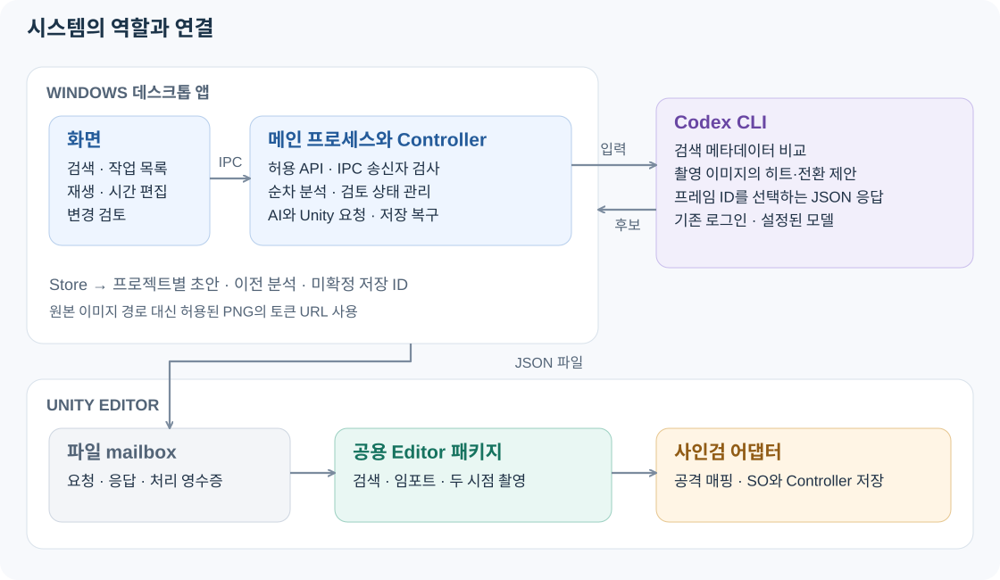
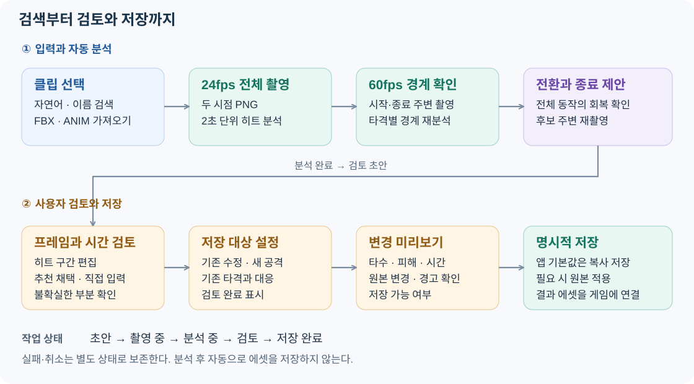
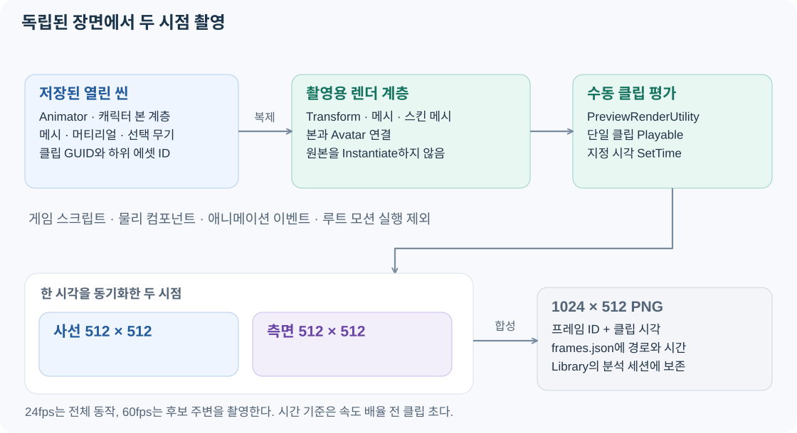
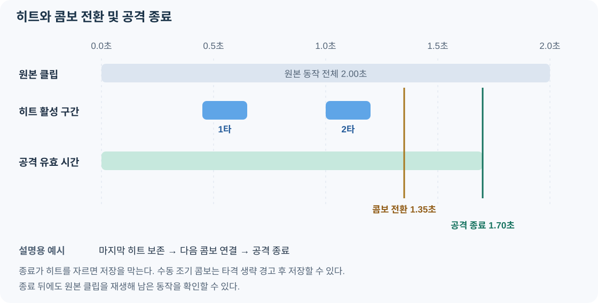
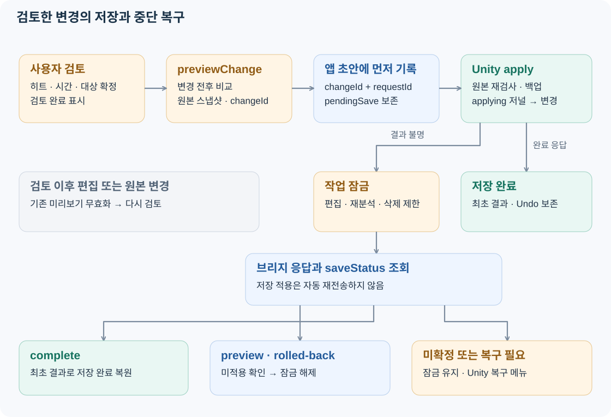
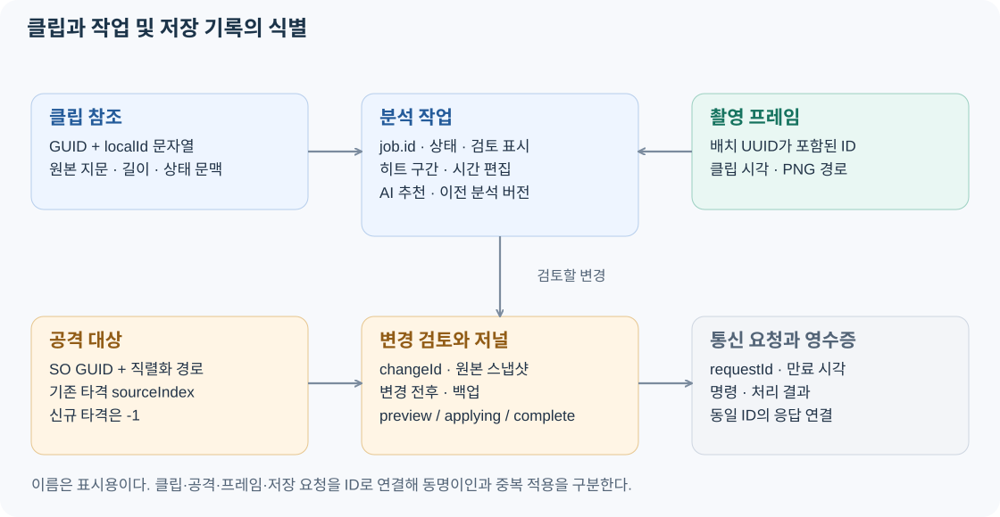

# AutoHitTimer 시스템 문서

스튜디오 백호의 **AutoHitTimer 0.3.0**은 애니메이션을 찾아 공격의 히트 구간, 다음 콤보 전환, 공격 종료 시점을 검토하고 사인검의 공격 데이터에 저장하는 Windows 도구다. Unity가 동작을 촬영하고, Codex가 후보를 제안하며, 사용자가 시간을 보정한 뒤 저장한다.

기준일은 **2026년 11월 4일**이다. 현재 저장소의 작업 트리에 구현된 데스크톱 앱, AI 분석, Unity Editor 패키지, 사인검 어댑터와 설치·복구 시스템을 다룬다. 아래 시간 그림의 숫자는 설명용 예시다.

## 1 전체 구조



화면은 작업을 요청하고 결과를 보여준다. 실제 파일 접근, 분석 실행, 초안 저장은 Electron의 메인 프로세스가 맡는다. Unity와는 프로젝트 안의 JSON 파일을 주고받으며, 게임 고유 데이터 변경은 사인검 어댑터에 모은다.

| 시스템 | 책임 | 주요 구현 |
| --- | --- | --- |
| 데스크톱 화면 | 프로젝트·캐릭터 선택, 검색, 작업 목록, 재생, 타임라인 편집, 저장 검토 | `renderer/index.html`, `app.js`, `styles.css` |
| 작업 제어 | 검색 취소, 순차 분석, 편집 상태, 미리보기 유효성, 저장 복구 | `src/controller.cjs`, `domain.cjs` |
| AI 연결 | 자연어 후보 정렬, 이미지 분석, 응답 검증, 오류·취소 처리 | `src/ai.cjs` |
| 로컬 데이터와 통신 | 초안 보존, 파일 요청·응답, 촬영 이미지 접근 | `src/store.cjs`, `project-client.cjs` |
| Unity 공용 패키지 | 캐릭터·클립 검색, 파일 임포트, 두 시점 촬영, 명령 전달 | `Packages/com.studiobaekho.auto-hit-timer/Editor` |
| 사인검 어댑터 | 공격 목록, 타격 대응, 시간 검증, SO·Controller 저장 및 복구 | `Integrations/FourTigerSword/AutoHitTimer/Editor` |
| 설치 시스템 | 연결 키트 배치, Package Manager 설치, 기존 모듈 갱신 | `src/install.cjs`, `Installer/Editor`, `scripts/Install-AutoHitTimer.ps1` |

SO는 공격 설정을 보관하는 Unity ScriptableObject 에셋이다. Animator Controller는 상태와 재생 클립의 연결을 보관한다. 공용 패키지는 Editor 전용이며 게임 빌드에 런타임 코드를 추가하지 않는다. 이 저장소의 현재 범위에는 Combat Lab과 제거된 이펙트 편집 기능이 포함되지 않는다.

## 2 사용자가 진행하는 작업



1. Unity에서 사인검 프로젝트를 열고 컴파일을 마친다. 플레이 모드를 끝내고 캐릭터가 있는 씬을 저장한다.
2. 앱에서 프로젝트를 연결한다. 필요한 경우 연결 모듈을 설치·복구한 뒤 목록을 새로고침하고 Animator와 무기를 선택한다.
3. 원하는 동작을 자연어로 찾거나 이름으로 검색한다. `.fbx`와 `.anim` 파일을 드롭해 가져올 수도 있다.
4. 클립을 작업 목록에 넣고 분석한다. 여러 작업은 순차 실행한다.
5. 두 시점의 프레임을 보며 히트 구간을 수정한다. 콤보·종료 추천을 비교하고 필요한 값을 직접 채택하거나 입력한다.
6. 기존 공격 수정 또는 새 공격 등록을 선택한다. 타격 대응과 시간 설정을 확인하고 검토 완료를 표시한다.
7. 변경 미리보기에서 에셋·클립·타수·피해 변화와 경고를 확인한 뒤 저장한다. 앱은 복사 저장을 기본으로 선택한다.

| 화면 영역 | 주요 기능 |
| --- | --- |
| 프로젝트와 검색 | 연결·설치, 캐릭터·무기 선택, 자연어·이름 검색, 후보 선택 |
| 작업 목록 | 작업 추가·선택·삭제, 순차 분석, 실패 사유와 진행 상태 확인 |
| 미리보기와 타임라인 | 두 시점 동시 재생, 히트 경계와 콤보·종료 마커 편집 |
| 히트와 전환 | 기존 타격 대응, 구간 추가·삭제, 현재값과 AI 추천 비교 |
| 저장과 등록 | 대상 SO·공격 단계·템플릿 선택, 시간 설정, 원본·복사 저장 |

재생 속도는 0.25배·0.5배·1배다. `Space`로 재생하고 `←/→`로 촬영된 프레임을 이동한다. 시간 마커에 포커스한 상태의 방향키는 해당 마커를 1/60초씩 옮긴다. 공격 종료 뒤의 원본 클립도 계속 재생해 잘리는 후속 동작을 확인할 수 있다.

## 3 애니메이션 검색과 가져오기

자연어 검색은 이름·에셋 경로·Animator 상태명·길이를 설명과 비교한다. 예를 들어 “검으로 짧게 찌르기, 회전 베기와 활 제외”를 입력하면 후보와 한국어 추천 이유를 받는다. 검색 단계에는 촬영 이미지가 없으므로 실제 동작은 작업에 추가한 뒤 확인한다.

Unity 후보 목록을 300개씩 끝까지 읽고, 클립 GUID·하위 에셋 ID·상태명으로 중복을 구분한다. Codex는 160개씩 비교해 묶음별 후보를 고른다. 후보가 많으면 추천을 다시 함께 비교해 최종 최대 20개를 반환한다. 서로 다른 묶음의 점수를 단순 합산하지 않는다. `이름으로 찾기`는 AI 호출 없이 클립명·상태명·경로를 검색한다.

검색 취소, 새 검색, 프로젝트·캐릭터 변경 뒤에 도착한 이전 응답은 화면에 반영하지 않는다. AI 인증이나 연결에 실패하면 이유를 표시하며 이름 검색을 사용할 수 있다.

프로젝트 외부의 `.fbx`와 `.anim`은 내용 해시를 붙인 파일명으로 `Assets/AutoHitTimer/Imports`에 복사한다. 같은 내용은 재사용하고, FBX에 여러 클립이 있으면 사용자가 고른다. 가져오기는 한 번에 최대 100개 파일, 파일 하나는 최대 512 MiB다. Rig·Avatar를 자동 보정하지 않으며 호환되지 않으면 Unity에서 설정을 맞춘 뒤 다시 검색해야 한다.

## 4 게임 동작을 실행하지 않는 촬영



캐릭터는 저장된 열린 씬의 Animator를 `GlobalObjectId`로 식별한다. 촬영용 장면에는 Transform, MeshFilter, MeshRenderer, SkinnedMeshRenderer와 필요한 본 계층을 새로 구성한다. 게임 스크립트·물리 컴포넌트를 복제하지 않고 애니메이션 이벤트와 루트 모션을 끈다. 독립된 미리보기 장면에서 단일 클립 Playable을 지정 시각에 평가한다.

프레임 하나는 사선 512×512와 측면 512×512를 합친 **1024×512 PNG**다. 시간은 공격 속도 배율을 적용하기 전의 클립 초 단위다. 스킨 메시에는 수동 평가 직후에도 갱신된 자세가 렌더되도록 스키닝 행렬 재계산 설정을 적용한다.

촬영은 Editor 업데이트마다 한 프레임씩 진행한다. 취소, 컴파일, Play Mode 전환, 종료 시 Playable과 미리보기 장면을 정리한다. 촬영 중 클립의 지문이 바뀌면 이전 프레임과 섞어 저장하지 않도록 분석을 중단한다.

| 촬영 데이터 | 의미 |
| --- | --- |
| `sessionId` | 한 분석에서 여러 촬영 요청을 묶는 ID |
| 프레임 `id` | 촬영 배치 UUID를 포함하는 고유 ID |
| 프레임 `time` | 속도 배율 전 클립 시각 |
| 프레임 `path` | Unity 프로젝트 Library 내부 PNG 경로 |
| `frames.json` | 프레임 ID·시각·경로 목록 |
| `sourceFingerprint` | 분석 후 클립 원본 변경을 확인하는 지문 |

## 5 히트와 전환을 분석하는 AI

### 히트 구간 분석

전체 클립을 24fps로 촬영한 뒤 2초 단위로 분석한다. 구간은 0.25초 겹쳐 경계에 걸린 타격을 놓치지 않도록 한다. AI는 준비·장식·복귀 동작을 제외한 시각적 공격 활성 구간을 제안한다. 인접 묶음에서 같은 타격을 중복 제안하면 시간 겹침과 경계 차이를 기준으로 합친다.

각 후보의 시작·종료 앞뒤 약 0.15초를 60fps로 재촬영한다. 기존 문맥과 촬영 프레임을 합쳐 타격마다 경계를 다시 분석하며, 현재 제어기의 입력 예산은 최대 96장이다. 후보가 명확하지 않으면 불확실 상태를 유지한다. 타격 없음으로 판정하면 해당 후보를 제거할 수 있다.

AI는 임의의 초 값을 만들어 반환하지 않고 **제공된 프레임 ID를 선택**한다. 앱이 ID를 실제 촬영 시각으로 변환한다. 히트 결과는 `hits`, `no-hit`, `uncertain` 중 하나이며 최대 64개 구간과 근거를 포함한다.

### 콤보 전환과 공격 종료 분석

히트 분석 뒤 전체 시간 범위를 균등하게 대표하는 최대 96프레임으로 콤보 전환과 공격 종료를 제안한다. 히트 주변에 프레임이 몰려 있어도 전체 동작을 골고루 포함한다. 확실한 후보는 주변 구간을 60fps로 재촬영해 전체 문맥 32장과 국소 최대 64장으로 다시 확인한다. 긴 범위는 최대 두 번에 걸쳐 좁힌다.

마지막 히트보다 이른 추천, 종료보다 늦은 콤보, 불확실한 히트가 포함된 결과는 검토가 필요한 상태로 남긴다. 판단할 수 없으면 `frameId: null`을 사용한다. 불확실한 추천의 적용 버튼은 비활성화되며 사용자가 직접 시간을 설정한다. 추천은 현재 편집값과 별도로 보관하고 자동 저장하지 않는다.

### 실행과 실패 처리

AI는 기존 Codex CLI 로그인과 설정된 모델을 사용한다. 실행은 임시 디렉터리에서 이뤄지며 사용자 설정 전체를 가져오지 않고 모델 선택만 읽는다. 도구 사용을 제한한 읽기 전용 실행에 메타데이터 또는 명시한 촬영 이미지를 전달하고 JSON 스키마로 응답을 검증한다. 별도 API 키 입력 화면은 없다.

타이밍 분석만 실패하면 완료한 히트 분석과 수동 시간 편집은 남는다. 인증·사용 한도 등 다음 작업도 진행하기 어려운 오류에서는 큐를 중단한다. 취소는 AI 프로세스와 Unity 촬영에 전달된다. 다시 분석하면 기존 시간 편집을 유지하고 이전 결과를 최대 5개 버전으로 보관한다.

**24fps와 60fps는 촬영 간격이며 정확도 수치가 아니다.** 이 시스템은 실제 충돌이나 게임 플레이를 측정하지 않는다. AI에는 검색 메타데이터·검색어 또는 촬영 이미지·클립 정보가 전달된다.

## 6 히트 구간과 공격 시간의 관계



히트 구간은 피해를 주는 활성 시간대이고, 콤보 전환은 일반 콤보의 다음 공격으로 연결할 시점이다. 공격 종료는 현재 공격을 끝내는 시점이며 스킬·궁극기 단계에서는 다음 단계로 진행하는 기준으로 사용한다. 원본 클립 길이와 공격 종료는 서로 다를 수 있다.

| 현재 편집 가능한 시간 | 직렬화 경로 | 규칙 |
| --- | --- | --- |
| 공격 종료 | `Execution.Duration` | 0보다 크고 클립 길이 이하. 모든 히트와 사용 중인 시간 설정을 포함 |
| 다음 콤보 전환 | `Execution.ComboTransitionTime` | 일반 콤보에서 사용. 0 이상, 공격 종료 이하 |
| 이동 시작·종료 | `Execution.Movement.MovementStartTime`, `Execution.Movement.MovementEndTime` | 사용 중일 때 시작·종료 순서와 종료 범위 검사 |
| 타겟 접근 종료 | `Execution.Movement.TargetApproach.ApproachEndTime` | 활성화된 타겟 접근 설정에 적용 |
| 타겟 회전 종료 | `Execution.Movement.TargetApproach.RotationEndTime` | 해당 공격에서 사용하는 회전 시간 검사 |
| 트레일 시작·종료 | `Feedback.Trail.TrailStartTime`, `Feedback.Trail.TrailEndTime` | 사용 중일 때 시작·종료 순서와 종료 범위 검사 |
| 슬래시 시작 | `Feedback.Slash.SlashVFXStartTime` | 절대 시각 또는 `-1` 자동 시점 유지 |

총 9개 시간 필드다. 비활성 설정은 기존 값을 보존하며, 활성 여부는 공격 종류와 이동·피드백 옵션에 따라 결정한다. 히트는 `0 ≤ start < end ≤ 공격 종료 ≤ 클립 길이`를 만족해야 한다. 마지막 히트보다 이른 수동 콤보 전환은 타격 생략 가능성을 경고한 뒤 저장할 수 있다. 종료가 히트를 자르는 경우는 저장을 막는다.

같은 클립의 기존 공격을 수정하면 기존 종료 시간을 기본으로 유지한다. 새 공격, 클립 교체, 빈 상태의 클립 연결은 클립 길이를 기본값으로 삼는다. 사용자가 직접 입력하거나 채택한 종료 시간이 우선한다. 대상 공격이나 템플릿을 바꾸면 이전 대상의 시간 편집을 초기화하며 클립의 AI 추천은 남긴다.

## 7 사인검 공격 데이터와 타격 대응

사인검 어댑터의 ID는 `four-tiger-sword`다. `WeaponActionDataSO`를 검색하고 SO GUID와 실제 직렬화 경로로 공격 단계를 식별한다. 예를 들어 `Actions.ComboSteps.Array.data[0]`는 특정 SO의 일반 콤보 첫 단계다.

| 공격 종류 | 현재 지원 |
| --- | --- |
| 모든 폼 일반 콤보 | 기존 보정·신규 등록 |
| 모든 폼 공중 착지 마무리·반격 | 기존 보정·신규 등록 |
| 화·금 폼 스킬 | 기존 보정·신규 등록 |
| 금 폼 궁극기 | 기존 보정·신규 등록 |
| 수 폼 강공격·스킬·궁극기, 목·토 특수 스킬, 버프 궁극기 | 미지원 사유 표시·저장 제외 |

각 히트의 `sourceIndex`는 기존 타격과의 대응이다. 0 이상의 인덱스를 선택하면 해당 타격의 피해·피드백을 보존한다. `-1`은 새 타격이며 `Damage`와 `PoiseDamage`를 0으로 설정해 공격 기본값을 상속한다. 같은 기존 타격을 여러 후보에 중복 대응할 수 없다. 타수가 늘면 총 피해도 늘 수 있으므로 미리보기의 피해 합계 변화를 확인한다. 이 합계는 모든 타격이 한 대상에 적중할 때의 기본 피해 계수이며 공격력·치명타·폼 효과는 포함하지 않는다.

기존 공격 수정은 상태 이름·전환·기존 밸런스를 유지하면서 시간을 바꾸고 필요하면 클립을 연결·교체한다. 같은 상태를 다른 공격도 참조하면 영향을 받는 공격을 보여준다. 그 공격들의 히트·시간 설정까지 자동으로 바꾸지는 않는다.

새 공격 등록은 같은 SO의 기존 공격을 템플릿으로 삼는다. 목록형 공격은 끝에 추가하고 공중·반격은 단일 항목을 생성하거나 교체한다. Animator 기본 레이어에는 고유 이름의 상태를 만든다.

| 저장 방식 | 변경되는 에셋 |
| --- | --- |
| 같은 클립의 기존 시간 수정 | 원본 또는 복사 SO |
| 기존 상태에 클립 연결·교체 | 원본 또는 복사 SO와 Controller |
| 새 공격과 Animator 상태 등록 | 원본 또는 복사 SO와 Controller |

복사 결과는 기본적으로 `Assets/StudioBaekho/AutoHitTimer/Results`에 저장한다. 복사된 SO·Controller를 실제 게임에 연결하는 작업은 사용자가 수행한다.

## 8 검토와 저장 및 중단 복구



앱의 작업 상태는 초안, 촬영 중, 분석 중, 검토, 저장 완료, 실패, 취소다. 분석이 끝나면 검토 상태가 된다. 검토 뒤 히트·시간·대상을 수정하면 검토 완료 표시와 기존 저장 미리보기를 무효화한다. 사용자는 새 변경 내용을 다시 확인해야 한다.

저장은 두 단계다. `previewChange`는 원본 SO·Controller·클립의 스냅샷을 기준으로 변경 내용과 저장 가능 여부를 만든다. `apply`는 그 미리보기의 `changeId`를 받아 스냅샷을 다시 검사한다. 사이에 원본이 바뀌었으면 오래된 결과로 덮어쓰지 못한다. 선택한 캐릭터·무기·부착 본 경로가 촬영 당시와 달라도 저장을 막는다.

앱은 적용 요청 전에 `changeId`와 `requestId`를 초안의 `pendingSave`에 기록한다. Unity 어댑터는 변경 전 파일을 백업하고, 에셋 변경에 앞서 저널을 `applying`으로 기록한 뒤 Undo 그룹 안에서 저장한다. 완료 결과를 기록하며 동일 `changeId`의 완료 요청에는 최초 결과를 반환한다.

저장 요청의 결과를 확정할 수 없으면 해당 작업의 편집·재분석·삭제를 잠근다. 앱은 브리지 응답과 어댑터의 `saveStatus`를 조회하며 적용을 자동 재전송하지 않는다.

| 어댑터 저장 상태 | 앱의 처리 |
| --- | --- |
| `complete` | 최초 저장 결과를 복원하고 저장 완료 처리 |
| `preview` | 미적용을 확인하고 잠금을 풀어 재검토 가능 |
| `rolled-back` | 롤백 완료를 확인하고 잠금 해제 |
| `applying` | 결과 확인까지 잠금 유지 |
| `recovery-required` | Unity 복구가 필요하며 잠금 유지 |
| `missing` | 기록 없음만으로 미실행을 단정하지 않고 추가 확인 필요 |

일반 저장 실패는 원복을 시도한다. 중단된 저장은 Unity의 `Tools → Studio Baekho → Auto Hit Timer → Recover Interrupted Save` 메뉴로 복구한다. 정상 저장은 Unity Undo도 지원한다. 원본 저장을 확인하면 해당 에셋의 기존 Inspector 편집도 함께 저장될 수 있다.

## 9 데이터 식별과 보존 위치



클립 이름만으로는 FBX 하위 클립이나 같은 이름의 에셋을 구분할 수 없다. `guid`와 문자열 `localId`를 함께 사용하며 64비트 하위 에셋 ID를 JavaScript 숫자로 변환하지 않는다. 촬영 프레임, 작업, 저장 미리보기, 통신 요청도 각각의 ID를 갖는다.

| 데이터 | 위치와 수명 |
| --- | --- |
| 프로젝트별 작업·설정·선택 상태 | `%APPDATA%/StudioBaekho/AutoHitTimer/projects/<프로젝트 경로 해시>.json` |
| 요청과 응답 및 영수증 | `<Unity 프로젝트>/Library/AutoHitTimerBridge/` |
| 촬영 PNG와 프레임 목록 | `Library/AutoHitTimerBridge/media/<session>/<batch>/` |
| 사인검 저장 저널과 스냅샷 | `Library/AutoHitTimer/four-tiger-sword/` |
| 외부 파일 임포트 | `Assets/AutoHitTimer/Imports/` |
| 복사 저장 결과 | `Assets/StudioBaekho/AutoHitTimer/Results/` |
| 설치 요청·결과 | `Library/AutoHitTimerInstall.json`, `AutoHitTimerInstallResult.json` |

초안은 임시 파일을 쓴 뒤 원자적으로 교체한다. 손상된 파일은 `.corrupt` 사본으로 보존한다. 앱 재시작 당시 촬영·분석 중이던 작업은 취소 상태로 복원하며 자동 재실행하지 않는다.

이펙트 편집 버전의 schema 2 초안은 원본 바이트를 `.effects-v2-backup`에 먼저 보존한 뒤 현재 schema 1로 변환한다. 기존 타격 작업과 미확정 저장 문맥을 유지하며 백업에 실패하면 변환을 진행하지 않는다. 현재 앱에는 이펙트 편집 기능이 없다.

Library를 지우면 촬영 프레임·통신 기록·로컬 저장 복구 기록도 사라진다. Assets에 저장된 원본과 최종 결과는 별도로 남는다. Undo·저널은 버전 관리를 대신하지 않는다.

## 10 Unity 통신과 설치

### 파일 mailbox 통신

`requests → processing → responses`는 요청이 대기·처리·완료되는 파일 폴더다. `receipts`에는 처리 기록을 남긴다. 요청 ID, 프로토콜 버전, 만료 시각으로 응답을 연결하고 같은 ID의 완료 요청에는 기존 응답을 반환한다. 재시작 때 실행 중이던 요청은 `INTERRUPTED`로 기록하며 자동 재실행하지 않는다.

| 명령 | 용도 |
| --- | --- |
| `status`, `actors` | 연결 상태와 씬 Animator 목록 |
| `search`, `import` | 클립 목록·이름 검색, 외부 파일 가져오기 |
| `capture`, `cancel` | 촬영 시작과 취소 |
| `targets` | 어댑터의 공격 대상·지원 기능·시간 설정 |
| `previewChange`, `apply` | 변경 검토와 적용 |
| `saveStatus` | 저장 저널의 상태를 읽기 전용으로 조회 |

요청·응답은 각각 최대 1 MiB다. 클라이언트는 임시 JSON을 완성한 뒤 UUID 파일명으로 게시한다. `status.json`의 프로젝트 경로와 갱신 시각을 확인해 다른 프로젝트나 오래된 연결을 거부한다. 앱은 미처리 요청의 시간 초과와 이미 실행됐을 수 있는 불확실한 시간 초과를 구분한다.

화면에는 Node.js 파일 권한을 직접 노출하지 않는다. 격리된 preload의 허용 API를 통해 메인 프로세스에 요청하며 IPC 송신자를 확인한다. 촬영 이미지도 원시 경로 대신 `aht-media://frame` 토큰 URL로 보여주고 현재 프로젝트의 허용된 PNG만 읽는다.

### 설치와 배포

앱의 연결 모듈 설치 또는 아래 스크립트는 프로젝트 루트와 사인검 `WeaponActionDataSO.cs`를 확인한 뒤 설치 파일을 배치한다.

```powershell
./scripts/Install-AutoHitTimer.ps1 -UnityProject 'C:/path/to/Four-Tiger-Sword'
```

| 설치 위치 | 역할 |
| --- | --- |
| `AutoHitTimerIntegration/Package` | 로컬 UPM 패키지 |
| `AutoHitTimerIntegration/Adapter` | 어댑터 설치 원본 |
| `Assets/StudioBaekho/AutoHitTimerBootstrap/Editor` | 패키지 설치를 시작하는 부트스트랩 |
| `Assets/StudioBaekho/AutoHitTimer/Editor` | 실제 컴파일되는 사인검 어댑터 |

부트스트랩은 Unity Package Manager의 `Client.Add`로 로컬 패키지를 추가한다. 패키지 의존성은 Newtonsoft JSON 3.2.2다. 이후 어댑터를 복사하고 설치 결과를 기록한다. 기존 프로젝트의 다른 패키지 의존성은 유지하며, 제거된 이펙트 모듈의 명시된 파일만 정리한다.

```powershell
cd Apps/AutoHitTimer
pnpm install
pnpm start
pnpm package:win
```

배포 결과는 `Apps/AutoHitTimer/dist/0.3.0/AutoHitTimer-win32-x64/AutoHitTimer.exe`다. EXE와 `UnityIntegration`을 포함한 전체 배포 폴더가 필요하다. 패키지는 Unity 6000.0 이상을 대상으로 하며 저장소의 실제 Unity 검증 버전은 6000.3.10f1이다. 0.3.0의 종료 시간 저장에는 앱과 연결 모듈 양쪽 갱신이 필요하다.

## 11 지원 조건과 검증 상태

### 현재 제한

| 항목 | 조건 |
| --- | --- |
| 클립·작업 | 클립 길이 0초 초과·120초 이하, 프로젝트당 최대 300작업 |
| 히트 | 최대 64개. 타격 없음은 분석 결과로 남지만 빈 히트 저장은 불가 |
| 촬영 요청 | 앱은 최대 480프레임씩 분할. Unity 단일 요청 상한은 7200프레임 |
| 애니메이션 상태 | 기본 Animator Controller의 기본 레이어, 단일 클립, 상태 속도 1, 오프셋 0 |
| 미지원 상태 | 동기화 기본 레이어, Blend Tree, Override Controller, 동적 속도·시간 파라미터, 미러링, 연속 단계의 동일 상태 재사용 |
| 캐릭터 | 저장된 열린 씬의 Animator, 유효한 Humanoid Avatar 또는 맞는 Generic 바인딩 계층 |
| 저장 | 원본 지문 일치, 사용자 검토, 최신 미리보기, 타이밍 기능을 지원하는 어댑터 |

### 확인된 결과와 남은 범위

| 검증 | 결과와 범위 |
| --- | --- |
| 2026년 11월 4일 현재 작업 트리 Node 시험 | 67개 중 66개 통과, 실패 0, 1개 건너뜀. Windows 파일 심볼릭 링크 생성 권한 시험이며 디렉터리 junction 거부 시험은 통과 |
| 2026년 10월 27일 Unity 기록 | 별도 Unity 6000.3.10f1 프로젝트에서 EditMode 19/19, 어댑터 회귀 PASS |
| 2026년 10월 27일 Electron 기록 | 모의 데이터 기반 실제 UI 및 별도 프로필의 main 시작 검증 통과 |
| 실제 Codex 실행 기록 | 촬영 PNG 분석과 프레임 ID·시간 대응 확인. 불확실한 결과도 불확실로 보존 |
| 사람 기준 정확도 | 타수 일치율·경계 오차의 실측은 아직 미완료 |
| 전체 게임 플레이 | 입력 기반 콤보, 무입력 이동 복귀, 스킬 단계 전환의 통합 플레이 검증은 아직 미완료 |

현재 실행한 Node 시험과 이전 Unity·UI 실행 기록을 구분한다. 자세한 재현 조건과 시점은 [검증 기록](../Apps/AutoHitTimer/VALIDATION.md)에 있다.

```powershell
cd Apps/AutoHitTimer
pnpm test
pnpm smoke
node scripts/evaluate.cjs human.json real-ai.json report.json
```

평가 도구는 사람이 라벨링한 자료와 편집 전 실제 AI 결과를 GUID·하위 에셋 ID로 대응시킨다. 타수 일치율과 평균·최대 경계 오차를 밀리초로 보고하며 누락 클립 수를 따로 기록한다. 타수가 같은 클립만 시간순으로 경계를 비교한다. 모의 데이터의 테스트 통과를 AI 정확도 결과로 사용하지 않는다.

### 상황별 확인 순서

| 상황 | 확인할 내용 |
| --- | --- |
| Unity에 연결되지 않음 | 프로젝트 루트, Editor 실행, 컴파일 오류, Play Mode, 설치 결과, 목록 새로고침 |
| 캐릭터가 목록에 없음 | 열린 씬 저장 여부와 Animator 존재 여부 |
| 클립이 호환되지 않음 | Rig·Avatar, Generic 본 경로, Legacy 여부, 상태 속도·오프셋 |
| AI 검색·분석 실패 | Codex 로그인·사용 한도·모델 이미지 지원·연결 상태. 검색은 이름 모드 사용 가능 |
| 저장이 차단됨 | 타이밍 모듈 갱신, 공격 종료 범위, 히트 대응, 원본 변경 여부, 다시 검토 |
| 저장 결과가 불확실함 | 작업 잠금 유지, Unity 연결 복구, 저장 상태 조회, 필요 시 Recover Interrupted Save |
| Library 삭제 뒤 그림이 없음 | 해당 작업을 다시 촬영·분석 |

## 12 구현을 찾아보는 길잡이

| 확인하려는 시스템 | 소스 |
| --- | --- |
| 화면·마커·추천 채택 | [app.js](../Apps/AutoHitTimer/renderer/app.js), [index.html](../Apps/AutoHitTimer/renderer/index.html) |
| IPC·이미지 접근·앱 시작 | [main.cjs](../Apps/AutoHitTimer/src/main.cjs), [preload.cjs](../Apps/AutoHitTimer/src/preload.cjs) |
| 큐·검색·분석·검토·저장 복구 | [controller.cjs](../Apps/AutoHitTimer/src/controller.cjs) |
| 히트 검증·프레임 샘플링·추천 검증 | [domain.cjs](../Apps/AutoHitTimer/src/domain.cjs) |
| AI 프롬프트·출력 스키마·CLI 실행 | [ai.cjs](../Apps/AutoHitTimer/src/ai.cjs) |
| 초안·마이그레이션·통신 | [store.cjs](../Apps/AutoHitTimer/src/store.cjs), [project-client.cjs](../Apps/AutoHitTimer/src/project-client.cjs) |
| Unity 요청 처리 | [AutoHitTimerBridge.cs](../Packages/com.studiobaekho.auto-hit-timer/Editor/AutoHitTimerBridge.cs) |
| 캐릭터·클립·임포트 | [AutoHitTimerScene.cs](../Packages/com.studiobaekho.auto-hit-timer/Editor/AutoHitTimerScene.cs), [AutoHitTimerAssets.cs](../Packages/com.studiobaekho.auto-hit-timer/Editor/AutoHitTimerAssets.cs) |
| 격리 촬영 | [AutoHitTimerCapture.cs](../Packages/com.studiobaekho.auto-hit-timer/Editor/AutoHitTimerCapture.cs) |
| 어댑터 인터페이스 | [AutoHitTimerAdapters.cs](../Packages/com.studiobaekho.auto-hit-timer/Editor/AutoHitTimerAdapters.cs) |
| 사인검 저장·스냅샷·복구 | [FourTigerAutoHitTimerAdapter.cs](../Integrations/FourTigerSword/AutoHitTimer/Editor/FourTigerAutoHitTimerAdapter.cs) |
| 타격 매핑·시간 규칙·피해 합계 | [FourTigerHitMapping.cs](../Integrations/FourTigerSword/AutoHitTimer/Editor/FourTigerHitMapping.cs) |
| 설치·배포 | [install.cjs](../Apps/AutoHitTimer/src/install.cjs), [AutoHitTimerInstaller.cs](../Installer/Editor/AutoHitTimerInstaller.cs), [package.cjs](../Apps/AutoHitTimer/scripts/package.cjs) |
| 검증·사람 기준 비교 | [Node tests](../Apps/AutoHitTimer/tests), [Unity tests](../Packages/com.studiobaekho.auto-hit-timer/Tests/Editor/AutoHitTimerTests.cs), [어댑터 회귀](../Integrations/FourTigerSword/AutoHitTimer/Editor/FourTigerAutoHitTimerRegression.cs), [evaluate.cjs](../Apps/AutoHitTimer/scripts/evaluate.cjs) |

다른 게임을 연결하려면 `IAutoHitTimerAdapter`의 `Id`, `Targets`, `PreviewChange`, `Apply`, `SaveStatus`를 구현하고 등록한다. 게임별 타격·시간 매핑, 원본 변경 검사, Undo와 저장 트랜잭션은 해당 어댑터의 책임이다. 현재 앱의 설치·폼·시간 경로는 사인검에 맞춰져 있으므로 새 게임에는 데스크톱 연결부도 함께 조정해야 한다.

문서 원본은 `docs/SYSTEMS.md`이며 그림과 HTML은 `node docs/build-docs.cjs`로 생성한다. HTML에는 그림이 포함되어 별도 인터넷 연결 없이 읽고 브라우저에서 인쇄할 수 있다.
