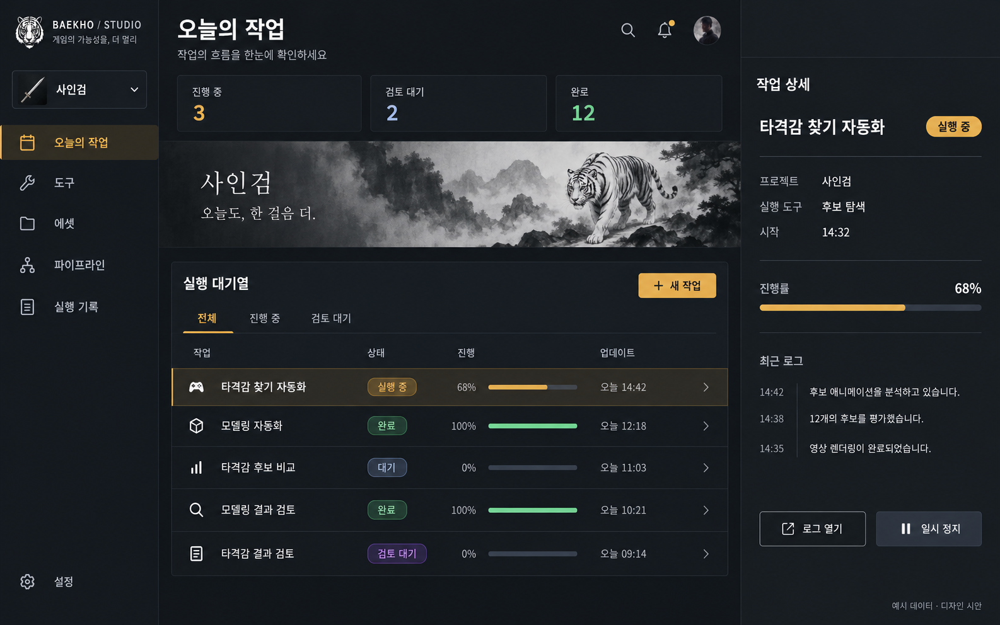
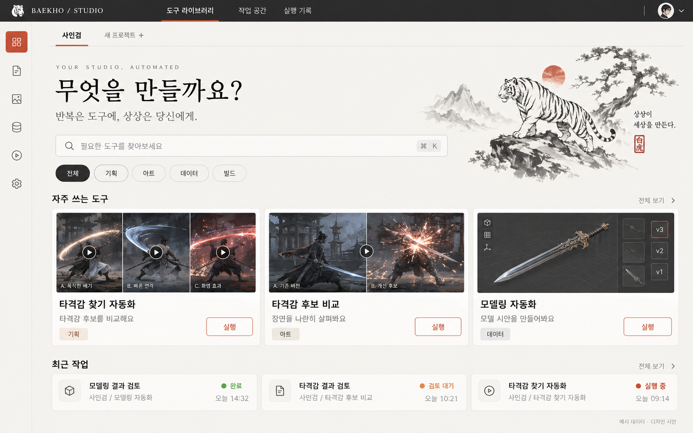
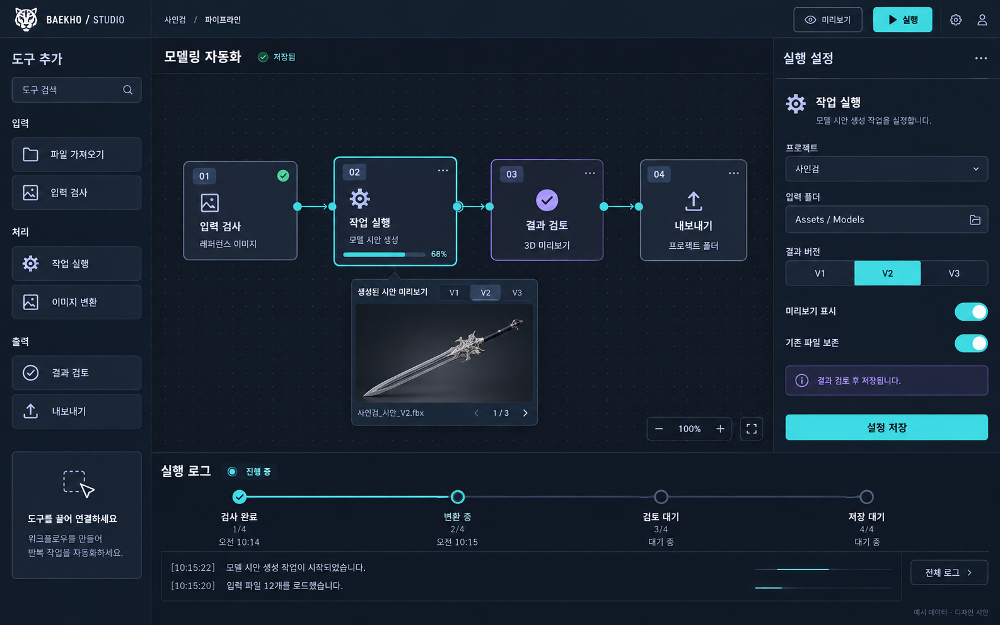

# 피그마 화면과 디자인 참고 자료

기준일: 2026-10-08

## 최신 합의와 시안의 관계

**B 작업실형을 공통 입구로, A 관제형의 작업 목록을 실행 메뉴로 활용합니다. 도구에 들어간 이후의 내부 화면과 전문 작업 흐름은 팀원이 만든 작업물을 사용합니다.**

피그마와 생성 이미지는 이 합의를 논의하기 위해 만든 시안입니다. 화면의 내부 배치, 세부 조작, 예시 데이터가 모두 구현 요구사항으로 확정된 것은 아닙니다. 시안과 최신 결정이 다르면 [기본 UI·UX 규칙](ux-principles.md)을 우선합니다.

## 피그마 화면 바로가기

[Studio Baekho — Automation UI · 3 Directions](https://www.figma.com/design/y6gk92aj7awRKvBtrQ5ca8)

| 화면 | 링크 | 활용 범위 |
| --- | --- | --- |
| A · 관제형 — Control Room | [화면 열기](https://www.figma.com/design/y6gk92aj7awRKvBtrQ5ca8?node-id=3-76) | 실행 목록, 상태 요약, 선택한 작업 상세의 참고 |
| B · 작업실형 — Atelier | [화면 열기](https://www.figma.com/design/y6gk92aj7awRKvBtrQ5ca8?node-id=3-77) | 공통 도구 선택 화면의 기본 방향 |
| C · 파이프라인형 — Pipeline | [화면 열기](https://www.figma.com/design/y6gk92aj7awRKvBtrQ5ca8?node-id=3-78) | 실제 다단계 연결 요구가 있을 때 검토할 확장안 |
| D · 공통 결과 비교 작업대 | [화면 열기](https://www.figma.com/design/y6gk92aj7awRKvBtrQ5ca8?node-id=3-79) | 비교·선택·보관 경험의 예시. 모든 도구에 동일한 패널을 강제하지 않음 |
| 공통 UI·UX 구조와 팀 모듈 규칙 | [보드 열기](https://www.figma.com/design/y6gk92aj7awRKvBtrQ5ca8?node-id=3-80) | 메뉴·상태·역할 분담의 초안. 내부 미리보기 통일 여부는 최신 규칙 참조 |

피그마에는 텍스트·프레임·버튼 인스턴스·도구 카드 등 편집 가능한 레이어가 있습니다. A/B/C는 1440×960, D는 1440×1120, UX 보드는 1440×1040 기준으로 작성했습니다. 아래 생성 이미지와 피그마 편집 레이어는 같은 방향을 탐색한 별도 산출물이므로 픽셀 단위로 동일하지 않습니다.

GitHub 저장소 접근 권한과 피그마 파일 접근 권한은 별개입니다. 링크가 열리지 않으면 팀장에게 해당 피그마 파일 접근을 요청합니다.

## A · 관제형

진행 중 작업, 실패, 검토 대기 결과를 한눈에 살펴보는 방향입니다. 실제 진행률이 없는 도구에는 이미지의 백분율 대신 단계 이름과 경과 시간을 사용합니다.

## B · 작업실형

도구의 용도와 시각 결과를 넓게 보여주는 방향입니다. 타격감 찾기와 모델링처럼 미리보기가 중요한 작업의 공통 입구로 사용합니다. 이미지 속 세부 카테고리와 추가 카드 수는 예시입니다.

## C · 파이프라인형

여러 단계의 연결 관계와 선택한 단계의 설정을 보여주는 방향입니다. 단일 도구를 사용하기 위해 노드를 연결하도록 요구하지 않습니다. 단계 연결 가능 여부는 각 도구의 구현을 확인한 뒤 판단합니다.

## 시각 요소 사용 원칙

| 항목 | 참고 기준 | 적용 방법 |
| --- | --- | --- |
| 글꼴 | 피그마: Noto Sans KR | 공통 영역의 가독성과 한국어 줄바꿈을 우선 |
| 배치 | 공통 탐색 + 작업 영역 + 필요한 상세 정보 | 내부 편집기와 패널 구성은 도구에 맞게 유지 |
| 색상 | A: 차콜·앰버 / B: 아이보리·주홍 / C: 네이비·민트 | 최종 테마 선택 시 공통 영역부터 적용 |
| 컴포넌트 | 버튼, 상태 표현, 카드, 기본 여백 | 기존 도구의 충돌 지점부터 점진적으로 맞춤 |
| 미디어 | 생성 이미지와 벡터 미리보기 | 실제 게임 에셋·영상·3D 결과로 검증된 자료가 아님 |

## 파일과 출처

- [시안 비교 HTML](../design/index.html): 저장소를 내려받은 뒤 브라우저로 열기. 별도 빌드나 외부 CDN이 필요하지 않습니다.
- [이미지 생성 프롬프트](../design/concepts/prompts.txt): 내장 ImageGen으로 만든 A/B/C 콘셉트의 입력 기록입니다.
- 세 PNG는 시각 탐색 자료입니다. 화면 속 수치, 인물, 게임 장면, 버전, 파일 형식은 예시이며 제품의 실제 동작을 보증하지 않습니다.

## 변경할 때

공통 탐색·상태·보관 규칙이 바뀌면 [기본 규칙](ux-principles.md), 이 문서, 해당 피그마 화면의 영향을 함께 검토합니다. 도구 내부 UI만 바뀌는 경우에는 [인계 양식](templates/tool-handoff.md)과 도구별 설명을 갱신하고, 공통 경험이 유지되는지 확인합니다.
