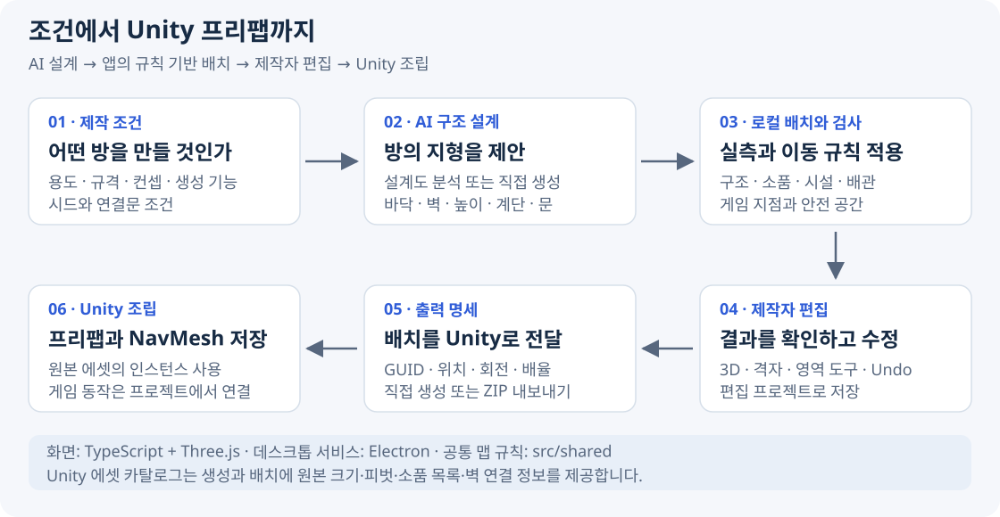
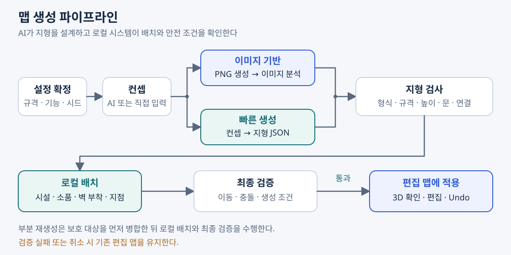
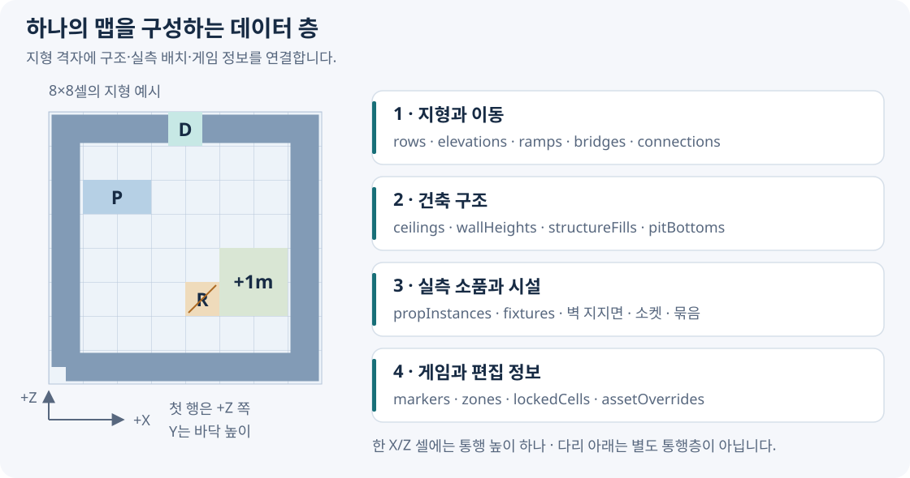
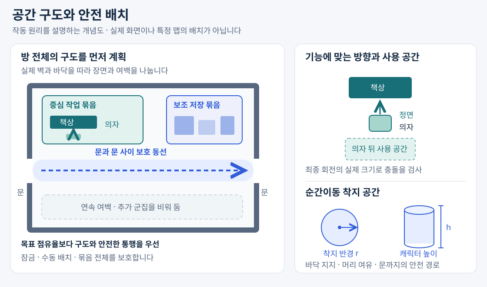
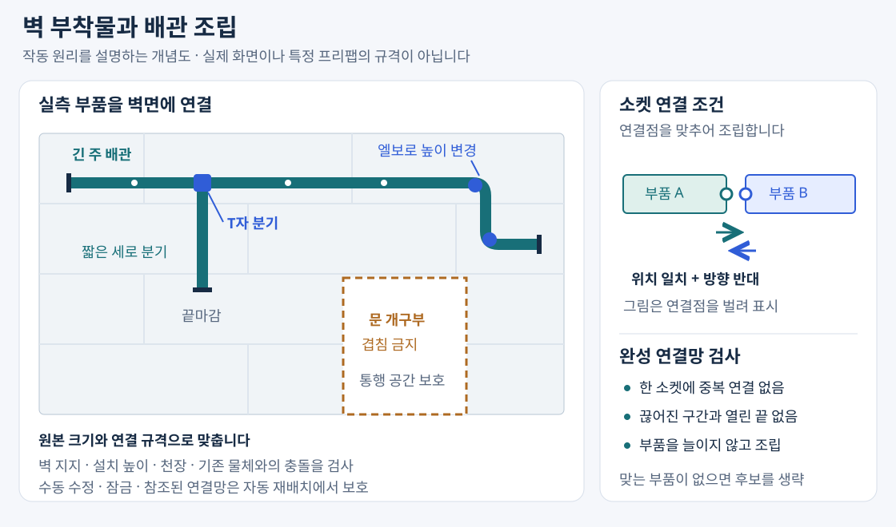
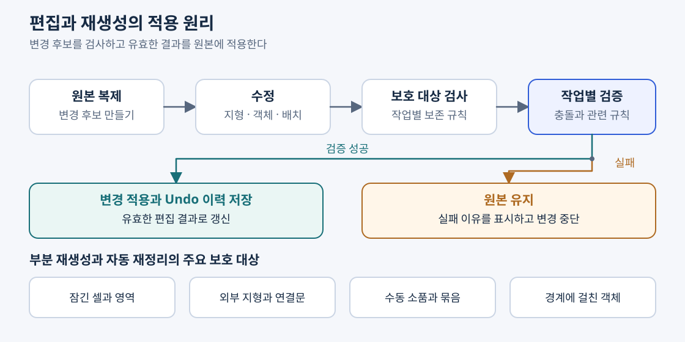
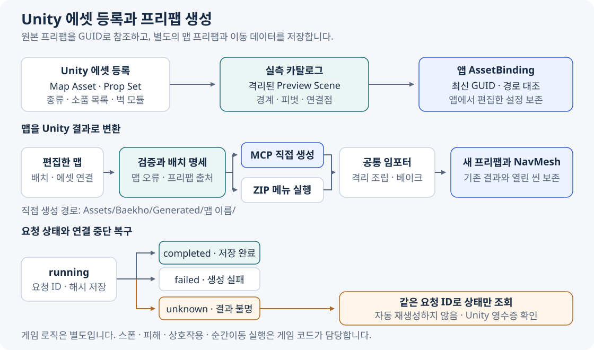

# Baekho Map Forge 시스템 설명서

Baekho Map Forge는 3인칭 3D 로그라이크의 **방 모듈을 설계하고 기존 Unity 프리팹으로 조립하는 Windows 데스크톱 앱**입니다. AI가 방의 구조를 제안하고, 앱이 실측 에셋과 이동 조건에 맞춰 배치를 계산하며, Unity가 최종 프리팹과 NavMesh를 만듭니다.

기준일은 **2026년 11월 4일**입니다. 이 설명서는 현재 작업 폴더의 구현을 다루며 아직 커밋하지 않은 기능도 포함합니다. `package.json`의 버전은 0.8.0이지만, 이 문서의 모든 기능이 기존 배포 EXE에 포함되어 있다는 뜻은 아닙니다. 그림은 코드의 동작 원리를 설명하는 개념도입니다.

브라우저에서 그림과 함께 읽으려면 [시스템 설명서 HTML](implemented-systems.html)을 여세요. 상세 제작 절차는 [README](../README.md), 벽 에셋 제작은 [벽 부착 프리팹 안내](wall-mounted-prefabs.md), 임포터 설치는 [Unity 안내](../unity-importer/README.md)를 참고하세요.

## 전체 시스템과 제작 흐름

제작자는 방의 용도·규격·컨셉·필요한 게임 요소를 선택합니다. 이미지 기반 또는 빠른 생성으로 지형을 얻고, 생성 결과를 3D와 격자 화면에서 다듬습니다. Unity 프로젝트의 에셋을 연결하면 원본 크기를 반영해 소품과 설비를 배치할 수 있습니다. 완성한 맵은 편집용 프로젝트로 저장하거나 Unity 프리팹으로 출력합니다.

| 시스템 | 하는 일 | 주요 결과 |
| --- | --- | --- |
| 생성 조건과 컨셉 | 방 용도, 크기, 시드, 기능, 공간 의도를 결정 | 동일 작업에서 공유하는 생성 요청 |
| AI 구조 생성 | 설계도 이미지 분석 또는 지형 직접 설계 | 바닥·벽·높이·계단·다리·연결문 |
| 구조와 이동 검사 | 높이 연결, 문, 천장, 위험 회피 경로 확인 | 오류 위치와 레벨디자인 진단 |
| 실측 소품과 구도 | 중심 장면, 보조 공간, 여백, 기능 관계 구성 | 크기와 정면이 반영된 소품 인스턴스 |
| 벽 부착과 배관 | 부착점·소켓으로 벽 설비와 연결망 조립 | 지지 벽과 연결 정보를 가진 시설 |
| 게임 지점 | 적·보상·이벤트·순간이동 위치 지정 | 게임 코드에서 사용할 마커 |
| 편집과 보존 | 영역 편집, 잠금, 재정리, Undo, 복구 | 검토하고 계속 수정할 수 있는 프로젝트 |
| Unity 연동 | 등록 에셋 조회, 프리팹 조립, NavMesh 베이크 | 새 `.prefab`과 `.NavMesh.asset` |

기술적으로 화면은 TypeScript와 Three.js, 데스크톱 기능은 Electron으로 구성합니다. `src/shared`의 공통 코드가 생성·편집·검증·내보내기에서 같은 맵 규칙을 사용하게 합니다. 화면에서 파일이나 프로세스를 직접 다루지 않고 `preload.ts`의 제한된 API를 통해 Electron 서비스에 요청합니다.

코드: [화면 진입점](../src/main.ts), [3D 미리보기](../src/preview.ts), [Electron 진입점](../electron/main.ts), [화면 API](../electron/preload.ts).

## 생성 조건과 두 가지 AI 생성 방식

### 방 규격과 컨셉

방 프리셋은 소형·중형·대형 전투방, 보스방, 시작방, 보상방, 상점방을 제공합니다. 프리셋은 다음 생성의 크기와 요소를 정하며 현재 편집 중인 맵을 바꾸지 않습니다. 사용자 지정 크기도 사용할 수 있습니다.

| 프리셋 | 가로와 세로의 선택 범위 | 기본 적 지점 | 기본 보상 지점 | 연결문 |
| --- | --- | --- | --- | --- |
| 소형 전투방 | 10~12셀 | 4 | 1 | 2 |
| 중형 전투방 | 14~18셀 | 6 | 2 | 4 |
| 대형 전투방 | 22~26셀 | 10 | 3 | 4 |
| 보스방 | 22~26셀 | 1 | 1 | 1 |
| 시작방 | 8~10셀 | 0 | 0 | 1 |
| 보상방 | 8~10셀 | 0 | 4 | 1 |
| 상점방 | 10~12셀 | 0 | 0 | 1 |

프리셋에서는 가로와 세로를 각각 범위 안의 2셀 간격 값으로 선택합니다. 기본 셀 간격은 2m입니다. `resolveGenerationSettings`가 작업 시작 시 크기·시드·설계 패턴을 한 번 확정하므로 컨셉 작성과 지형 생성이 서로 다른 크기를 사용하지 않습니다.

컨셉은 AI 자동 작성과 직접 입력을 지원합니다. 방 용도와 켠 기능을 반영하고, 시작·보상·상점방에는 전투 요소를 억지로 추가하지 않습니다. 공간 의도는 진입과 이탈 방향, 폭 변화, 주 공간의 비중, 보조 공간, 높이 지형의 위치를 조합합니다. 사용자 설정과 설명이 이 제안보다 우선합니다.

### 이미지 기반과 빠른 생성

| 방식 | 처리 과정 | 보관하는 중간 결과 |
| --- | --- | --- |
| 이미지 기반 | 컨셉 → PNG 설계도 → 이미지 분석 → 지형 JSON | 설계도와 분석 재시도용 초안 |
| 빠른 생성 | 컨셉 → 지형 JSON 직접 설계 | 완성 맵과 컨셉 |

새 프로젝트와 생성 방식이 없는 기존 파일은 이미지 기반을 사용합니다. 빠른 생성은 이미지 단계 두 개를 생략하지만 AI 구조 설계 시간이 필요하므로 일정한 완료 시간을 보장하지 않습니다. 선택한 모델과 연결된 Codex의 추론 설정을 사용합니다.

AI의 출력 범위는 지형·높이·계단·문·다리입니다. 천장, 시설, 게임 마커, 실측 소품, 벽 부착물은 로컬 규칙으로 추가합니다. 두 방식은 `finalizeLayout`에서 공통 처리하며 JSON 구조, 요청한 기능과 수량, 지형과 통행 조건을 검사합니다. 실패한 응답을 샘플 맵으로 대체하지 않습니다.

이미지 초안에는 생성 당시 설정·컨셉·선택 영역·카탈로그를 함께 저장합니다. 초안을 분석할 때는 현재 생성 방식 선택과 관계없이 이미지 분석 경로를 사용합니다. 빠른 생성이 성공하면 이전 설계도와 초안을 정리하며 실패·취소 시 기존 맵과 초안을 유지합니다.

코드: [생성 서비스](../electron/services/codex.ts)의 `generateConcept`, `generateImage`, `extractLayout`, `generateLayout`, `finalizeLayout`; [방 프리셋](../src/shared/room-presets.ts); [공간 의도](../src/shared/spatial-intent.ts); [프롬프트](../electron/services/prompts.ts).

## 여러 후보와 부분 재생성

여러 후보 생성은 **2~8개를 순차 처리**합니다. 다음 후보에 앞선 컨셉과 실제 완성 지형의 요약을 전달하여 다른 공간 구성을 유도합니다. 실패한 후보는 이유를 표시하고 다음 후보를 계속 처리합니다. 취소하면 완성된 후보는 남고 진행 중·대기 중 후보는 중단합니다.

구조 비교는 소품과 조명을 제외하고 외곽 여백·회전·반사를 정규화합니다. 완전 중복은 제외하고, 윤곽과 높이·계단·문·동선 관계가 비슷한 후보는 경고합니다. 같은 구조에 장식만 바꾼 결과를 새로운 구조로 계산하지 않습니다. 실패나 중복 때문에 AI를 자동 재호출하지는 않습니다.

선택 영역 재생성은 원본 맵과 같은 크기의 후보를 받아 **선택 영역의 수정 가능한 부분만 병합**합니다. 영역 밖, 잠긴 셀, 기존 연결문, 경계를 걸친 보호 대상을 유지한 뒤 로컬 배치와 경계 연결 검사를 실행합니다. 전체 생성과 달리 지역 병합이 로컬 배치보다 먼저입니다.

후보를 현재 편집 화면에 적용하는 작업은 Undo로 되돌릴 수 있습니다. 선택한 후보들은 각자의 `.baekho.json`이 들어 있는 ZIP으로 저장합니다. 후보 목록 자체는 실행 중 메모리에 있으므로 보관할 후보는 저장해야 합니다.

시드는 규격 선택·공간 의도·로컬 배치에 사용합니다. AI 이미지나 AI 지형 응답까지 완전히 같은 결과로 만드는 장치는 아닙니다.

코드: [후보 생성](../src/shared/variants.ts), [구조 유사도](../src/shared/geometry-similarity.ts), [후보 화면](../src/variants.ts), [영역 병합](../src/shared/editing.ts)의 `mergeGeneratedRegion`.

## 맵 데이터와 좌표 규칙

`ProjectFile`은 맵(`map`), 생성 설정(`settings`), 에셋 연결(`bindings`), 선택적인 컨셉·설계도·초안을 함께 저장합니다. 지형은 문자열 격자와 높이 행렬로 표현하고 추가 기능은 별도 목록으로 연결합니다.

| 데이터 | 의미 |
| --- | --- |
| `rows`, `elevations` | 타일 종류와 각 셀 바닥의 Y 높이 |
| `ramps`, `bridges`, `connections` | 높이 연결, 다리 축, 외부 연결문 |
| `ceilings`, `wallHeights` | 천장 아랫면과 벽 높이, 자동·수동 설정 |
| `structureFills`, `pitBottoms`, `cliffs` | 문 주변·단차·구덩이의 구조 마감 |
| `propInstances` | 실측 크기, 점유 셀, 배율 참조, 회전, 묶음, 생성 출처 |
| `fixtures` | 조명·설비·장식·벽 부착물 및 시설 간 연결 |
| `markers` | 적·보상·이벤트·순간이동 위치와 게임 연결 키 |
| `assetOverrides`, `lockedCells`, `zones` | 개별 에셋 지정, 편집 보호, 전투·보상·휴식 구역 |

타일 문자는 `_` 빈 공간, `.` 바닥, `#` 벽, `D` 연결문, `P` 통행 차단 소품, `R` 계단·경사로, `B` 다리입니다. 실측 소품은 `propInstances`에 종류 참조·회전·크기를 저장합니다. 인스턴스가 없는 기존 `P` 타일은 일반 소품 바인딩으로 출력합니다.

좌표는 맵 중심이 원점이며 X/Z는 바닥 평면, Y는 높이입니다. 첫 행은 +Z 쪽이고 행 번호가 늘면 −Z로 이동합니다. 셀 중심은 `X = (x + 0.5 − width / 2) × cellSize`, `Z = (height / 2 − row − 0.5) × cellSize`입니다. 방향 0/90/180/270은 북/동/남/서입니다. 계단 방향은 올라가는 방향, 연결문 방향은 방 바깥쪽입니다.

| 규격 | 현재 지원 범위 |
| --- | --- |
| 격자 크기 | 가로·세로 각각 8~40셀 |
| 셀 간격 | 0.25~10m |
| 셀 바닥 높이 | −100~100m |
| 계단·경사로 오름폭 | 0.25~10m |
| 연결문 | 폭 0.25~40m, 높이 0.25~20m, 생성 요청 1~16개 |
| 에셋 등록 | 최대 256개 |
| 순간이동 생성 목표 | 1~64개, 기본 비활성 |
| 편집 프로젝트 / Unity 출력 | `formatVersion: 1` / 현재 `schemaVersion: 4 또는 5` |

현재 기능을 사용하는 맵은 `map.version: 5`를 사용할 수 있고 기존 v4도 유지합니다. 이전 프로젝트의 v1~v3 맵은 읽을 때 v4로 옮기며 기존 높이·배율·에셋 지정을 보존합니다. 새 기능을 자동 추가하지 않습니다. 옛 S/E 타일은 바닥으로 바뀌므로 외부 연결문을 별도로 지정해야 합니다.

코드: [데이터 타입](../src/shared/types.ts), [파싱과 좌표 및 출력 명세](../src/shared/map.ts), [저장 형식 정규화](../electron/services/validation.ts).

## 지형과 건축 구조

### 높이와 통행

일반 바닥의 높이 차이는 허용 단차 이내여야 합니다. 큰 높이 차이는 계단·경사로의 낮은 끝과 높은 끝으로 연결하며 옆면으로 통과하지 않습니다. 다리는 축 방향 양 끝으로만 연결하고 접속 높이를 확인합니다.

맵은 **한 X/Z 셀에 하나의 통행 높이**를 표현합니다. 다리 아래의 빈 공간과 구덩이 바닥은 추가 플레이 층으로 분석하지 않습니다. 겹친 복층이나 다리 아래 통행은 이 구조의 지원 범위 밖입니다.

### 천장과 마감

자동 평천장은 계단의 높은 끝을 포함한 최고 통행면 위에 여유 높이를 더해 배치합니다. 내부 구덩이 위도 이어지지만 방 바깥 빈 공간은 제외합니다. 벽은 자동 천장과 연동하고, 수동으로 지정한 천장·벽 높이는 따로 유지할 수 있습니다.

구조 보완은 문 위와 옆, 단차의 틈, 구덩이 벽과 하부를 채웁니다. 문 개구부를 막지 않으며 기존 벽의 위쪽 높이를 유지한 채 아래쪽 틈을 보완합니다. 구덩이 하단은 둘레의 최저 바닥에서 설정 깊이를 뺀 높이를 기준으로 하고 마감 바닥 또는 데드존을 둡니다.

Unity 출력에서는 바닥 윗면과 천장 아랫면을 지정 Y에 맞춥니다. 바닥·천장 두께는 셀 간격 × 0.12 × 두께 배율 Y입니다. 계단·경사로는 원본의 오름폭을 이용해 Y 배율을 계산합니다. 원본은 낮은 쪽에서 +Z로 올라가는 형태를 기준으로 합니다.

코드: [구조 동기화](../src/shared/structures.ts)의 `synchronizeStructures`, [벽 기준면](../src/shared/wall-geometry.ts), [높이와 이동 검사](../src/shared/map.ts).

## 연결문과 레벨디자인 검사

연결문은 방 사이 접속을 위한 이름·종류·폭·높이·바깥 방향을 가집니다. 새 문의 기본 규격은 **가로 4m × 높이 3m**입니다. 실제 개방 셀 수는 `ceil(문 폭 / 셀 간격)`이며 넓은 문도 Unity에는 문 프리팹 하나로 내보냅니다.

문의 바깥은 맵 외부로 이어지는 공간, 안쪽은 높이가 맞는 통행 지형이어야 합니다. 내부에 갇힌 구멍은 방 외부로 인정하지 않습니다. 문 폭 전체의 바닥과 천장 여유를 확인하고, 다른 문·잠금·지형과 충돌하는 크기 변경은 적용하지 않습니다. 연결점은 문 전체 폭의 바깥 경계 중앙에 두며 프리팹의 시각적 오프셋과 독립적입니다.

레벨디자인 검사는 캐릭터 크기와 실제 높이 연결을 반영한 이동 그래프를 만듭니다. 기본 반경은 0.4m, 회피 거리는 3m입니다. 출입구 진입 공간, 위험물을 피하는 필수 경로, 목적물 접근, 회피 공간을 검사합니다. 선택한 패턴에 따라 열린 전투장, 장애물 양쪽으로 우회하는 전투장, 높은 지대에 분리된 두 계단 접근로를 가진 전투장을 확인합니다. 이 검사는 레벨디자인 설정과 배치 모드에 따라 적용하며 균형·묶음 배치의 우회로 미완성은 경고로 남을 수 있습니다.

`두 맵 연결 확인`은 다른 프로젝트의 문을 현재 문과 마주 보도록 회전·이동해 보여 줍니다. 종류·폭·높이와 대략적인 구조 겹침을 진단하며 원본을 수정하지 않습니다. 실제 방 조립과 맵 사이 통로, NavMeshLink 연결은 게임 프로젝트가 담당합니다.

코드: [문 점유](../src/shared/connections.ts), [레벨디자인](../src/shared/level-design.ts)의 `playerMovementGraph`, `analyzeLevelDesign`; [맵 비교](../src/shared/editing.ts)의 `compareModules`. 설계 원칙은 [레벨디자인 원칙](level-design-principles.md)에 정리되어 있습니다.

## 소품 실측과 방 구도

### 실측 배치

소품은 원본 크기·피벗, 등록 배율·Y 회전·오프셋, 방 용도·태그·가중치·통행 차단 여부를 사용합니다. 최종 회전이 적용된 경계를 축에 평행한 외접 상자로 계산하고 실제 점유 셀로 변환합니다. 같은 높이의 지지 바닥, 머리 공간, 문·시설·다른 소품과의 충돌, 이동 경로를 확인합니다.

좁은 곳에 맞추기 위해 원본 소품을 자동 축소하지 않습니다. 배치 결과에는 `bindingId`, 실제 크기, 점유 셀, 방향과 추가 회전, 묶음 ID, 자동·수동 출처가 남습니다. 이후 에셋 크기나 회전을 바꿔 기존 점유와 맞지 않게 되면 재배치가 필요하다고 진단합니다.

### 중심 장면과 보조 공간

소품 배치 모드는 기존 AI 의도를 유지하는 방식, 면적을 기준으로 채우는 방식, 구역별 묶음 구성으로 나뉩니다. 구역별 묶음 구성은 먼저 중심 장면, 보조 장면, 연속된 여백, 반드시 비워 둘 셀을 정합니다. 방을 고정 비율로 나누지 않고 실제 바닥 연결·입구 거리·벽 인접성·실측 크기를 사용합니다.

주 소품과 보조 소품은 용도·계열이 맞는 후보에서 고릅니다. 묶음 구성의 우선순위는 **앱에서 명시한 설정 → Unity Prop Set 소속 → 이름·분류 제안**입니다. 같은 묶음에서도 서로 다른 프리팹을 먼저 시도하고 사용 횟수와 가중치로 반복을 줄입니다. 세트의 모든 프리팹이 항상 함께 나오는 것은 아닙니다.

기본 소품 목표 점유율은 12%입니다. 목표는 부드러운 기준이며 구도·기능 관계·통행을 해치면서 수량을 채우지 않습니다. 공간에 들어가는 완성 묶음만 채택하고 부족한 배치는 이유를 표시합니다. 구도 계획 자체는 일시 계산 데이터이며 저장되는 것은 실제 배치 결과입니다.

### 사용 방향과 기능 관계

아래 규칙은 **구역별 묶음 구성의 새 생성과 자동 소품 재정리**에 적용합니다. 수동 각도 편집은 충돌과 안전 조건을 검사하지만 책상과 의자의 기능 관계까지 다시 강제하지 않습니다.

| 기능 | 배치 규칙 |
| --- | --- |
| 책상·탁자 | 호환 의자와 작업 공간을 구성 |
| 좌석 | 책상을 바라보고 뒤에 접근할 공간 확보 |
| 독립 설비 | 원본 정면 앞에 사용할 공간 확보 |
| 탁상 소품 | 자동 바닥 배치에서 제외, 현재 책상 위 배치 미지원 |
| 일반 보관 소품 | 묶음·충돌·동선 조건을 확인 |
| 자연물 | 자연 군집과 회전 변화로 배치하되 동일한 안전 조건 적용 |

책상과 독립 설비는 정렬을 유지합니다. 의자와 보관 소품은 최대 ±6°의 작은 차이, 자연물은 자유로운 Y 방향 변화를 줄 수 있습니다. 회전한 크기가 맞지 않으면 정렬된 후보를 다시 시도합니다. `frontYaw`는 원본 루트 +Z를 0°로 본 시각적 정면입니다. 이름이나 크기만으로 정면을 확정하지 않으므로 앱의 화살표와 Unity 메시를 비교해 보정합니다.

### 기존 맵에 적용

`빈 공간 자동 채우기`는 기존 지형과 배치를 유지하며 새 소품을 추가합니다. `자동 소품 재정리`는 이동 가능한 자동 소품을 복제 맵에서 다시 구성합니다. 수동·직접 수정·잠금·직접 에셋 지정·선택 경계를 걸친 소품을 보호하고, 묶음 일부가 보호 대상이면 전체를 보호합니다. 대체 배치가 없거나 안전 검사에 실패하면 기존 배치를 유지합니다.

코드: [실측 소품](../src/shared/props.ts), [방 구도](../src/shared/room-composition.ts), [묶음 배치](../src/shared/grouped-props.ts), [분류 우선순위](../src/shared/prop-composition.ts), [기능 규칙](../src/shared/prop-behavior.ts), [정면과 회전](../src/shared/prop-orientation.ts), [채우기와 재정리](../src/shared/furnishing.ts).

## 시설과 조명과 식생

시설은 난간·기둥·아치·물·위험물·함정·게이트·스위치·비밀문·휴식처·상인·제단·장식·식생·조명으로 구성합니다. 난간은 노출 절벽과 다리 옆을 따라 배치하고, 게이트와 스위치는 `linkedId`로 연결합니다. 구역 표식은 적·보상·휴식 시설의 우선 배치 위치로 사용합니다.

조명은 자동·천장·벽·천장과 벽 모드가 있습니다. 자동 모드는 유효한 천장이 있으면 천장 조명, 없으면 실내를 향하는 벽 조명을 사용합니다. 천장용·벽용 에셋을 구분하고 전용 에셋이 없으면 공용 조명을 사용합니다. 기존 조명에서 먼 후보를 선택해 분산하며 `천장과 조명 보정`으로 기존 맵에 다시 적용할 수 있습니다.

장식과 식생은 별도 역할·토글·밀도를 가집니다. 크기를 아는 경우 실측 소품으로 배치하고 묶음 모드에서는 지정한 용도·계열에 맞는 군집에 참여합니다. 식생의 통행 가능 여부는 `blocksMovement` 설정으로 결정합니다.

앱은 원본 프리팹의 Light·머티리얼·충돌체 설정을 사용합니다. 새 광원이나 피해·상호작용 코드를 자동 작성하지 않습니다.

코드: [추가 기능 배치](../src/shared/features.ts)의 `applyGeneratedFeatures`, `reapplyLighting`; [조명 에셋 선택](../src/shared/light-bindings.ts).

## 벽 부착물과 연결 배관

벽 설비는 바닥 소품과 다른 데이터로 저장합니다. 지지 벽면, 실제 월드 위치·회전, 설치 높이, 충돌 상자, 소켓, 연결망 ID를 가집니다. 설치 위치는 벽면·문 위·문 옆·상단·하단·코너로 구분합니다.

Unity의 `BaekhoWallModule`은 단일 부착물, 직선, 안쪽·바깥쪽 코너, 끝마감, 엘보, T자 부품을 정의합니다. 같은 계열의 호환 부품끼리 연결하며 **소켓 위치가 일치하고 방향이 서로 반대**여야 합니다. 부착점 +Z는 방 안쪽, 소켓 +Z는 부품 끝 바깥쪽을 가리킵니다. 실측 부품을 늘여 길이를 맞추지 않습니다.

새 프로젝트는 정돈된 자동 구도, 자동 높이, 가로와 세로 함께를 기본으로 사용합니다. 긴 주 배관과 짧은 분기를 만들고 호환 부품이 있으면 세로로 높이를 바꾼 뒤 가로로 이어집니다. 고정 높이·무작위 범위·자동 높이와 바닥 또는 벽 윗면 기준을 지원합니다. 기존 파일에 없는 새 설정은 기존 동작을 유지하도록 해석합니다.

후보는 지지 벽, 설치 높이, 천장·바닥·문 개구부, 캐릭터 통행, 다른 소품·부착물과의 충돌을 검사합니다. 연결망은 소켓 중복 사용·열린 끝·끊어진 구간도 검사합니다. `자동 배관 재배치`는 수동 수정·잠금·복사·다른 시설에서 참조한 연결망을 보호하고 가능한 자동 연결망만 다시 구성합니다.

대체 형상을 켜고 개별 벽 부착물 또는 배관 부품이 전혀 등록되지 않은 경우 해당 범주의 내부 임시 형상을 사용합니다. 임시 벽 조명·환기구·배관 등 총 10종을 제공하며, 실제 배관 일부가 등록된 상태에서 빠진 코너·엘보를 임시 부품으로 보충하지는 않습니다. 이는 블록아웃용이며 실제 프리팹 GUID를 꾸며 저장하지 않습니다. 등록 후 `임시 부착물 교체`를 실행하면 종류별 실제 에셋으로 바꿉니다. 한 항목이라도 교체 조건을 통과하지 못하면 일괄 교체를 취소합니다.

임시 형상이 남은 맵은 편집 프로젝트로 저장할 수 있습니다. **Unity 직접 생성과 ZIP 내보내기 전에는 임시 부착물을 모두 실제 프리팹으로 교체하거나 제거해야 합니다.** 임시 형상을 Unity 메시로 출력하는 기능은 없습니다.

코드: [벽 배치와 검사](../src/shared/wall-mounts.ts), [미배치 원인](../src/shared/wall-mount-diagnostics.ts), [임시 형상](../src/shared/wall-placeholders.ts), [일괄 교체](../src/shared/wall-replacement.ts), [Unity 벽 메타데이터](../unity-importer/Runtime/BaekhoWallModule.cs).

## 게임 마커와 순간이동 안전 지점

적·보상·이벤트 마커는 위치·방향·이름·게임 연결 키를 저장합니다. Unity의 게임 코드가 이 정보를 읽어 실제 콘텐츠를 실행합니다. 순간이동 마커는 여기에 착지에 사용할 캐릭터 반경과 높이를 함께 저장합니다.

순간이동 생성은 기본으로 꺼져 있으며 켜면 1~64개의 전체 목표를 지정합니다. **지형·시설·소품·벽 부착이 끝난 뒤 마지막에 배치**하므로 최종 장애물을 기준으로 판단합니다. 설정이 없을 때 검사 규격은 반경 0.4m, 높이 2m입니다.

| 검사 | 통과 조건 |
| --- | --- |
| 발판 | 일반 평지이며 착지 원판 전체가 동일 높이 바닥에 지지됨 |
| 머리 공간 | 저장할 캐릭터 높이만큼 천장과 시설의 여유가 있음 |
| 겹침 | 물·함정·위험물·소품·시설·다른 도착 지점과 겹치지 않음 |
| 이동 경로 | 캐릭터 크기를 반영해 위험물을 피하며 통과 가능한 문에 도달 |
| 부분 재생성 | 영역 밖·잠긴 지점과 착지 공간을 보호하고 부족분만 생성 |

적 생성 지점과의 최소 거리 규칙은 없습니다. 바닥 에셋에 위치 오프셋이 있어 발 위치와 지지면의 일치를 보장할 수 없는 경우도 후보에서 제외합니다. 목표 수량을 확보하지 못하면 기존 맵을 유지하고 이유를 표시합니다.

수동 추가·이동·삭제와 이름·게임 연결 키·방향 편집을 지원하며 높이는 바닥에 고정합니다. 지점이나 주변 배치의 편집으로 착지 공간이 깨지면 해당 변경을 적용하지 않습니다. Unity의 `BaekhoGameplayMarker.kind`는 `teleport`, Transform은 발밑 위치이며 `clearanceRadius`와 `clearanceHeight`를 제공합니다. 실행 중 이동·충돌체·동적 장애물 처리는 게임 코드에서 수행합니다.

코드: [순간이동 배치와 검사](../src/shared/teleport.ts), [마커 컴포넌트](../unity-importer/Runtime/BaekhoGameplayMarker.cs).

## 편집 화면과 변경 보존

화면은 3D 미리보기, 격자 배치 편집, AI 설계도, 후보 비교를 제공합니다. 3D는 구조·높이·방향을 확인하는 블록아웃이며 원본 Unity 메시와 머티리얼을 렌더링하는 최종 화면이 아닙니다.

| 도구 | 편집 범위와 보호 규칙 |
| --- | --- |
| 타일과 높이 | 셀 칠하기, 바닥 높이, 계단 방향과 오름폭, 벽·천장 높이 |
| 영역 복사와 붙여넣기 | 지형과 관련 층을 함께 복사하고 90° 회전·대칭 지원 |
| 전체 객체 보호 | 넓은 문·소품 묶음·벽 연결망을 일부만 잘라 복사하지 않음 |
| 잠금과 구역 | 셀 잠금, 전투·보상·휴식 위치 지정 |
| 개별 배치 | 소품 교체·회전·삭제, 시설과 게임 마커 편집 |
| 내 제작 템플릿 | 생성 조건·에셋·선택 영역을 이 PC의 로컬 저장소에 보관 |
| 에셋 관리 | 종류·배율·피벗·정면 수정, 일괄 배율, 등록 일괄 삭제 |

편집은 이전 상태를 보관하고 구조 동기화와 관련 안전 검사를 거쳐 적용합니다. 소품·벽·순간이동의 안전 공간을 깨는 변경은 되돌립니다. 일반 맵 오류는 화면에서 확인하며 편집 도중 미완성 맵을 저장할 수 있습니다. 내보내기 전에는 전체 맵 오류를 해결해야 합니다.

Undo는 최대 50개의 이전 상태를 보관하며 `Ctrl+Z`, Redo는 `Ctrl+Shift+Z`입니다. 영역 재정리나 일괄 등록·교체도 한 작업으로 복원합니다. 편집 후 약 1.2초 동안 추가 변경이 없으면 자동 복구 사본을 저장합니다. 복구 사본을 불러온 후에는 Unity 프로젝트를 다시 연결합니다.

등록 삭제는 관련 소품·직접 에셋 지정·벽 연결망 참조를 함께 처리합니다. 잠긴 셀의 실제 에셋이 달라지는 삭제는 거부합니다. 한편 공유 에셋의 배율 변경은 같은 에셋을 쓰는 잠긴 셀에도 영향을 주므로, 셀 잠금이 에셋 정의를 복제하거나 고정하는 기능은 아닙니다.

코드: [편집 UI](../src/designer.ts), [영역 변환](../src/shared/editing.ts), [소품 묶음 보호](../src/shared/prop-groups.ts), [등록 삭제](../src/shared/asset-deletion.ts), [일괄 배율](../src/shared/asset-scaling.ts), [작업 기록과 복구](../src/main.ts).

## Unity 에셋 등록과 소품 목록

Unity 프로젝트 연결은 `.prefab`과 `.meta`에서 GUID·경로를 읽습니다. 프리팹 목록을 스캔하는 일과 앱에서 사용할 에셋을 등록하는 일은 구분됩니다. 원본 에셋을 앱 프로젝트에 복사하지 않습니다.

사용할 프리팹 루트에 `BaekhoMapAsset`을 붙이고 Import Enabled와 Role을 지정하면 바닥·벽·문·계단·소품·조명·시설 등 25종류를 한 번에 가져올 수 있습니다. 실측 카탈로그는 별도 Preview Scene에서 원본 루트의 위치·회전을 초기화하고 스케일 1을 기준으로 Renderer와 지원 Collider의 경계를 측정합니다. 원본 프리팹과 열린 씬은 유지합니다.

다시 가져올 때 같은 GUID는 새로 등록하지 않고 경로·실측 크기·벽 연결 정보를 갱신합니다. 앱에서 편집한 이름·역할·배율·배치 조건은 유지합니다. 카탈로그에서 빠진 등록을 자동 삭제하지 않으며 가져오기만으로 기존 맵을 재배치하지 않습니다. 잘못된 항목은 제외 이유를 표시하고 등록 한도나 기존 배치 검사를 통과하지 못하면 전체 적용을 취소합니다.

Unity의 `BaekhoPropSet`은 함께 사용할 프리팹의 후보 목록입니다. 용도 Equipment/Storage/Natural과 배치 형태 Either/Wall/Island를 정하고 하나의 프리팹을 여러 목록에 포함할 수 있습니다. 목록에만 등록한 프리팹도 기본 소품·배율 1로 가져올 수 있습니다. 실제 주·보조 소품 선택과 위치·회전·간격은 앱에서 결정합니다.

실제 사용 순서는 **Unity 프로젝트 연결 → 스크립트 준비 → Unity에서 등록·묶음 지정 → 표시된 프리팹 가져오기 → 생성 또는 자동 소품 재정리**입니다. 카탈로그 조회와 스크립트 준비에는 AI Navigation이 필요하지 않습니다.

코드: [프로젝트 스캔](../electron/services/unity-project.ts), [카탈로그 병합](../src/shared/unity-asset-catalog.ts), [등록 컴포넌트](../unity-importer/Runtime/BaekhoMapAsset.cs), [카탈로그 생성](../unity-importer/Editor/BaekhoAssetCatalog.cs), [실측](../unity-importer/Editor/BaekhoPropCatalog.cs), [소품 목록](../unity-importer/Runtime/BaekhoPropSet.cs).

## Unity 출력과 NavMesh

### 직접 생성과 ZIP

두 출력 방식은 같은 `prepareExportManifest`와 `buildManifest`로 맵 오류와 에셋 출처를 검사하고 공통 Unity 임포터를 사용합니다.

| 방식 | 필요한 환경 | 결과와 특징 |
| --- | --- | --- |
| Unity에 프리팹 생성 | 연결한 프로젝트의 실행 중 Editor, 로컬 MCP, AI Navigation | `Assets/Baekho/Generated/<맵 이름>/`에 명세와 새 출력 생성 |
| ZIP 내보내기 | 출력할 원본 프로젝트 연결, 가져올 때 Unity와 AI Navigation | JSON과 임포터를 옮긴 뒤 Unity의 Build Prefab 메뉴 실행 |

직접 생성은 AI 호출 없이 진행합니다. 기본 MCP 주소는 `http://127.0.0.1:8080/mcp`이며 로컬 HTTP 주소를 사용합니다. 실제 열린 Unity 프로젝트가 연결한 폴더와 같은지 검사하고 Play Mode·컴파일·갱신·컴파일 오류 상태를 확인합니다.

스크립트 설치는 앱이 설치했고 이후 수정되지 않은 파일만 자동 갱신합니다. 사용자 수정 스크립트와 `.meta`는 보존하며 호환되지 않는 기존 커스텀 임포터는 병합이 필요할 수 있습니다. 설치 기록은 `Library/BaekhoMapForge/integration.json`에 남습니다.

임포터는 격리된 Preview Scene에서 GUID로 원본 프리팹을 찾아 조립합니다. 원본의 컴포넌트와 중첩 참조를 유지하며 역할별 정렬 규칙을 적용합니다. 현재 씬을 수정하지 않고 기존 결과와 다른 새 파일명을 만듭니다. 실패한 저장에서 이번 시도의 불완전 산출물은 정리합니다. 기존 출력 JSON schema 1~5를 읽을 수 있습니다.

### 요청 기록과 연결 복구

직접 생성은 요청 ID와 정확한 명세 바이트의 SHA-256으로 추적합니다. 앱은 `unity-builds.json`, Unity는 `Library/BaekhoMapForge/requests/<요청 ID>.json`에 처리 기록을 남깁니다. 연결이 끊기면 결과를 모르는 `unknown` 상태가 될 수 있습니다.

이때 `같은 요청의 결과 확인`은 상태를 조회합니다. 결과가 불명확한 요청을 자동 재실행하지 않습니다. Unity 재시작 등으로 완료 기록이 불확실하면 출력 폴더와 요청 기록을 확인해야 합니다. 앱을 닫아도 이미 시작한 Unity 작업은 계속될 수 있습니다.

### NavMesh와 런타임 연결

맵 루트에 `NavMeshSurface`를 추가하고 프로젝트의 첫 Agent Type을 기본으로 베이크합니다. 수집 대상은 생성된 맵의 자식 Render Meshes와 Terrain이며 현재 씬의 다른 오브젝트는 포함하지 않습니다. 조각의 기존 NavMeshSurface는 생성 인스턴스에서만 비활성화합니다.

Collider를 가진 높은 소품에는 점유 영역을 보호하는 Not Walkable 볼륨을 적용하고 캐릭터가 올라설 수 있는 낮은 소품은 허용 단차 규칙을 따릅니다. Collider 전용 지형은 기본 Render Meshes 수집과 다르므로 Unity에서 Surface 설정을 조정하고 다시 베이크해야 합니다.

프리팹은 별도 `.NavMesh.asset`을 참조하므로 두 파일을 함께 보관합니다. 캐릭터 규격·지형·배치가 달라지면 다시 베이크하며 루트 배율은 1을 유지합니다.

| Unity 데이터 | 앱이 제공하는 것 | 게임 코드에서 연결할 것 |
| --- | --- | --- |
| `BaekhoMapConnection` | 문 ID·종류·폭·높이와 바깥 방향 | 방 조립, 통로, 방 사이 NavMesh 연결 |
| `BaekhoGameplayMarker` | 적·보상·이벤트·순간이동 위치와 키 | 스폰, 보상 지급, 이벤트, 실제 순간이동 |
| `BaekhoMapFixture` | 시설 역할과 `linkedId` | 함정 피해, 문 개폐, 상점·휴식·제단 |
| 원본 조명 프리팹 | 기존 Light와 머티리얼 설정 | 최종 조명 연출과 게임별 조정 |

코드: [Unity 브리지](../electron/services/unity-bridge.ts), [MCP 클라이언트](../electron/services/unity-mcp.ts), [설치 관리](../electron/services/unity-installation.ts), [요청 처리 도구](../unity-importer/Mcp/BaekhoBuildMapTool.cs), [공통 임포터](../unity-importer/Editor/BaekhoMapImporter.cs).

## 저장과 로컬 서비스

| 파일 또는 저장소 | 내용 | 포함하지 않는 것 |
| --- | --- | --- |
| `.baekho.json` | 편집 맵, 설정, 에셋 연결, 컨셉, 설계도와 초안 | Unity 원본 프리팹, 인증 파일 |
| 후보 저장 ZIP | 선택한 1~8개의 독립적인 편집 프로젝트와 안내 | 후보 목록의 실행 중 상태 |
| Unity 출력 ZIP | `Map.baekhomap.json`, Runtime·Editor 스크립트, 안내, 있으면 설계도 | 원본 프리팹, MCP 전용 어댑터 |
| 자동 복구 사본 | 최근 편집 프로젝트 | 원본 Unity 프로젝트의 연결 세션 |
| 내 제작 템플릿 | 이 PC의 조건·에셋·선택 영역 | 다른 PC로 자동 동기화 |

파일 저장은 같은 폴더의 임시 파일에 쓰고 동기화한 뒤 최종 이름으로 바꿉니다. 쓰기에 실패해 기존 저장 파일을 부분적으로 덮어쓰는 상황을 피합니다. 후보 ZIP은 최대 8개, 전체 128MiB 제한을 사용합니다. 원본 프리팹과 `.meta`는 Unity 프로젝트에서 별도로 보관해야 합니다.

AI 서비스는 앱 전용 Codex App Server와 표준 입출력 JSON-RPC로 통신합니다. 인증은 Codex가 관리하고 앱은 별도 API 키 입력을 요구하지 않습니다. 동시에 하나의 생성 작업을 실행하며 취소 신호를 해당 작업으로 전달합니다. 생성 요청에는 컨셉과 구조·카탈로그 정보가 사용되지만 Unity 원본 프리팹 파일을 보내지는 않습니다.

화면의 Node 접근은 꺼져 있고 Electron의 컨텍스트 격리와 샌드박스를 사용합니다. 네이티브 요청은 신뢰하는 앱의 메인 프레임에서 온 것인지 확인합니다. 파일 작업은 중복 실행을 막고 입력 JSON·이미지·경로·에셋 출처를 검사합니다.

단계별 시간·모델·추론 설정·제공된 토큰 사용량은 앱 데이터 폴더의 `codex/generation-metrics.jsonl`에 기록합니다. 이 측정 로그에는 프롬프트·이미지·인증 정보를 넣지 않습니다. 실제 AI 벤치마크의 별도 결과 폴더는 재현과 검토를 위해 입력·응답·설계도도 보관하므로 측정 로그와 구분해야 합니다.

코드: [프로젝트 저장과 내보내기](../electron/services/projects.ts), [입력 검사](../electron/services/validation.ts), [화면 신뢰 검사](../electron/services/page-trust.ts), [AI 전송](../electron/services/codex-transport.ts), [실행 환경 탐색](../electron/services/codex-runtime.ts).

## 검증 도구와 현재 지원 경계

테스트는 공통 로직, Electron 화면 흐름, 격리 Unity 임포터, 실제 AI 품질 검사를 구분합니다. 아래는 현재 저장소에 있는 실행 도구이며 이 문서 작성 과정에서 전체 제품 테스트를 다시 실행했다는 의미는 아닙니다. 이전 README의 버전별 통과 수치도 현재 작업 폴더 전체의 최신 결과로 해석하지 않습니다.

| 확인 대상 | 실행 명령 예시 |
| --- | --- |
| 공통 로직·서비스 회귀 | `npm test` |
| TypeScript와 배포 빌드 | `npm run build` |
| 빠른 생성·후보·순간이동 화면 | `npm run test:direct-generation`, `npm run test:variants`, `npm run test:teleport` |
| 소품·배관 화면 | `npm run test:grouped-furnishing`, `npm run test:wall-heights` |
| 카탈로그·MCP 연결 | `npm run test:asset-catalog`, `npm run test:unity-button`, `npm run test:unity:mcp` |
| 격리 Unity 배치 | `npm run test:grouped-unity`, `npm run test:wall-unity`, `npm run test:prop-orientation:unity` |
| NavMesh와 낮은 소품 | `npm run test:unity:navmesh`, `npm run test:unity:low-steps` |
| 실제 AI 공간 다양성 | `npm run test:spatial-ai`, `npm run test:spatial-quality` |
| 생성 시간·로컬 배치 측정 | `npm run benchmark:generations`, `npm run benchmark:grouped-props` |

실제 AI 명령은 로그인한 Codex를 호출하고 Unity 검사는 설치·라이선스와 격리 프로젝트 환경을 필요로 합니다. AI 속도 비교는 같은 컨셉·설정·시드를 공유하며 성공률과 성공한 결과의 중앙값·최댓값을 함께 봅니다. 실패한 요청의 짧은 시간을 속도 향상으로 계산하지 않습니다.

현재 완성 범위는 **검증 가능한 방 모듈의 설계·편집·에셋 조립**입니다. 다음 항목은 게임 프로젝트에서 마무리합니다.

- 원본 메시와 문틀 내부의 실제 통과 폭, 충돌체, 캐릭터 컨트롤러와 카메라 확인.
- 실행 중 장애물 변화, 순간이동 도착 충돌, 적 AI와 전투 동작.
- 보상·피해·문·스위치·상점 등 게임 로직.
- 여러 방의 런타임 조립, 맵 사이 복도, NavMeshLink 연결.
- 실제 메시·머티리얼·광원에서의 최종 시각 품질 확인.

겹친 복층과 다리 아래 통행, 탁상 소품의 책상 위 자동 배치는 현재 구현 범위에 포함되지 않습니다. 통행 검사와 NavMesh 베이크가 시각적 매력이나 실제 게임의 모든 플레이 상황을 보장하지는 않습니다.

코드와 기록: [실행 명령](../package.json), [단위·통합 테스트](../tests), [검증 스크립트](../scripts), [Unity 검증 코드](../tests/unity), [기존 실제 AI 검증 기록](level-design-validation.md).

## 문서 갱신 방법

시스템 동작이 바뀌면 이 Markdown과 해당 SVG를 수정하고 `node scripts/build-system-docs.mjs`를 실행합니다. HTML은 Markdown과 일곱 개의 SVG를 포함한 단일 파일로 생성되어 네트워크 연결 없이 열 수 있습니다. 코드 참조 링크는 저장소와 함께 열 때 사용할 수 있습니다.
