# Baekho Studio 시스템 문서

기준일 2026년 11월 4일 · Desktop 0.7.0 · Unity 연결 패키지 0.3.0

Baekho Studio는 전투 수치를 제안하고, Unity에서 실제로 실행하고, 결과를 비교하여 새 게임 데이터로 저장하는 Windows 데스크톱 도구입니다. 첫 모듈인 Combat Lab은 사람이 설명한 타격감을 AI 후보로 바꾸며, 최종 선택은 사람이 영상과 측정 기록을 보고 결정합니다.

이 문서는 `studio-baekho-tools`의 현재 작업 트리와 여기에 포함된 Four-Tiger-Sword 통합 자료를 다룹니다. 미커밋 구현도 포함하며, 기준 커밋은 `68a5e15`입니다. 별도 게임 저장소 전체의 시스템 설명은 범위에 포함하지 않습니다.

## 1 전체 시스템 구조

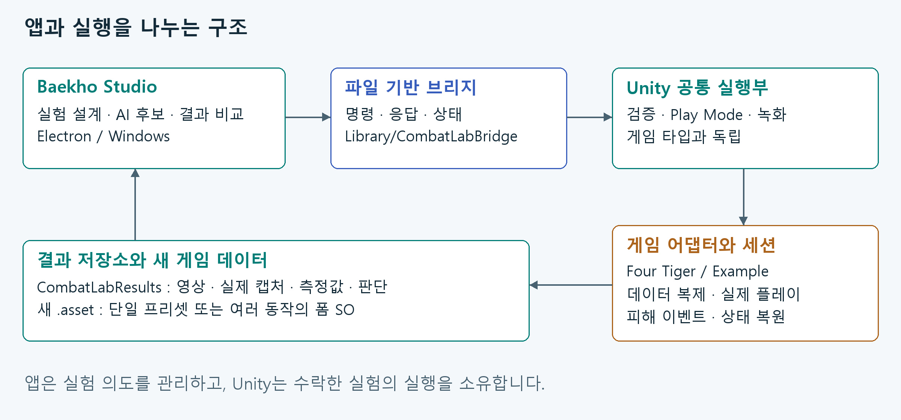

앱은 실험 의도와 후보를 관리하고, Unity는 실행과 녹화를 소유합니다. 공통 Unity 패키지는 게임 타입을 직접 참조하지 않습니다. 각 게임의 어댑터가 공격 데이터, 실제 입력, 상태 머신과 피해 이벤트를 연결합니다. 이 경계 덕분에 게임을 추가할 때 앱 전체를 다시 만들 필요가 없습니다.

| 시스템 | 책임 | 핵심 구현 |
|---|---|---|
| 데스크톱 워크스페이스 | 프로젝트 선택, 실험 설계, 이력, 비교 | `Desktop/renderer`, `Desktop/src/main.cjs` |
| AI 후보 생성 | 목표와 지원 항목으로 수치·곡선 제안 | `Desktop/src/ai-candidates.cjs` |
| 로컬 연결 | 요청·응답·상태 전달 | `project-client.cjs`, `CombatLabBridge.cs` |
| 공통 실험 실행부 | 검증, Play Mode 반복, 녹화, 보고서 | `Packages/com.studiobaekho.combat-lab` |
| 게임별 연결 | 원본 탐색, 복제, 자동 플레이, 내보내기 | `Integrations/FourTigerSword`, `Integrations/Example` |
| 결과 및 채택 | 영상·PNG·측정값 비교, 판단, 새 SO 생성 | `CombatLabResults`, 프리셋 `.asset` |

SO는 Unity의 ScriptableObject 데이터 에셋입니다. 여기서는 공격 단계, 타격 설정과 카메라 프로필을 담습니다. 후보는 원본을 덮어쓰는 명령이 아니라 실험에 사용할 설정 묶음입니다.

근거: [앱 진입점](../Desktop/src/main.cjs), [공통 계약](../Packages/com.studiobaekho.combat-lab/Editor/CombatLabContracts.cs), [게임 연결](../Integrations/FourTigerSword/Editor/FourTigerCombatAdapter.cs).

## 2 사용자가 진행하는 실험

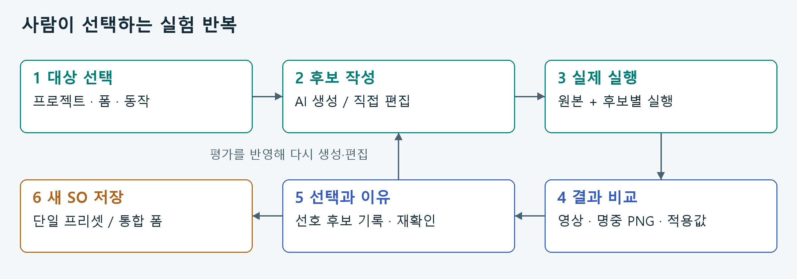

1. Unity 프로젝트와 저장된 테스트 씬을 준비하고 앱에서 프로젝트를 선택합니다.
2. 어댑터, 원본 폼, 테스트할 동작을 선택합니다. 연결이 반환한 지원 항목을 기준으로 편집합니다.
3. 목표와 AI 후보 수 2~12개를 정합니다. v2에서는 후보를 직접 만들거나 수치·곡선을 수정할 수도 있습니다.
4. 원본 비교, 고정 표적 또는 실전 모드, 시간, 반복과 캡처 조건을 정해 실행합니다.
5. 영상, 명중 전후 PNG, 실제 적용값과 시작 조건을 확인합니다. 필요하면 선택 후보를 3회 재확인합니다.
6. 선호 후보와 이유를 기록하고 새 프리셋 또는 여러 동작을 합친 폼 SO로 내보냅니다.

여러 동작을 선택하면 각각 목표·후보·최종 선택을 독립적으로 관리합니다. 한 동작의 후보를 다시 생성해도 다른 동작의 후보는 유지됩니다. 같은 데이터를 수정하는 전체 일반 콤보와 개별 일반 타격은 함께 선택할 수 없습니다.

원본이나 동작을 바꾸면 해당 연결의 메타데이터를 다시 확인해야 합니다. 프로젝트별 초안은 앱에 남지만, 현재 스키마와 맞지 않는 초안은 그대로 복원하지 않습니다. 새 실험과 내보내기에는 열린 Unity가 필요하며 저장된 결과는 연결 없이 읽을 수 있습니다.

근거: [화면과 상태 관리](../Desktop/renderer/app.js), [화면 구성](../Desktop/renderer/index.html), [다중 동작 검증](../Desktop/tests/multi-action-setup.test.cjs).

## 3 데스크톱 앱의 내부 구조

화면은 Electron renderer에서 실행되고, 프로젝트 파일 접근과 Unity 연결은 main 프로세스가 담당합니다. preload가 제한된 기능만 `window.baekho`로 공개합니다. AI 생성과 통합 저장 전에 main이 Unity 카탈로그를 확인하고, 실행 요청의 세부 유효성은 Unity 실행부에서도 검증합니다.

| 계층 | 담당 작업 | 경계 |
|---|---|---|
| Renderer | 폼 선택, 후보 편집, 영상 제어, 결과 표시 | Node.js 직접 접근 없음 |
| Preload | 허용된 IPC 메서드 제공 | 파일 시스템 전체를 노출하지 않음 |
| Main | 프로젝트 전환, AI 호출, 파일 선택, 내보내기 | IPC 발신 창과 프레임 확인 |
| ProjectClient | 상태 검사, 명령 전달, 보고서 열기 | 선택 프로젝트 내부 경로 검증 |
| Media response | 영상 스트리밍과 구간 요청 처리 | 보고서가 참조한 파일의 임시 토큰 사용 |

`contextIsolation`, sandbox와 CSP를 사용합니다. 프로젝트를 바꾸면 미디어 토큰을 폐기하며, 결과 파일과 브리지 경로에서 상위 경로 탈출과 junction·symlink 우회를 검사합니다. 이 구조는 로컬 앱의 파일 경계를 위한 것이며 원격 인증 서버는 아닙니다.

아래는 배포 앱의 실험 설계 화면을 검증한 기존 진단 스크린샷입니다. 원본과 동작은 진단용 데이터입니다.

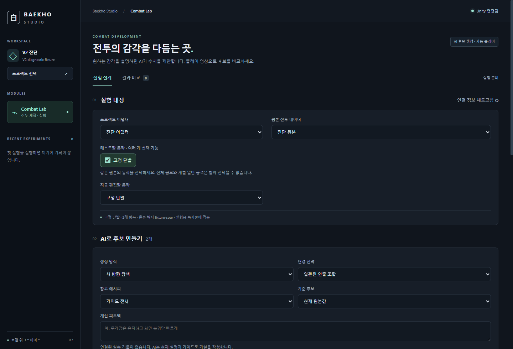

근거: [main](../Desktop/src/main.cjs), [preload](../Desktop/src/preload.cjs), [프로젝트 클라이언트](../Desktop/src/project-client.cjs), [미디어 처리](../Desktop/src/media-response.cjs).

## 4 AI 후보 생성과 개선

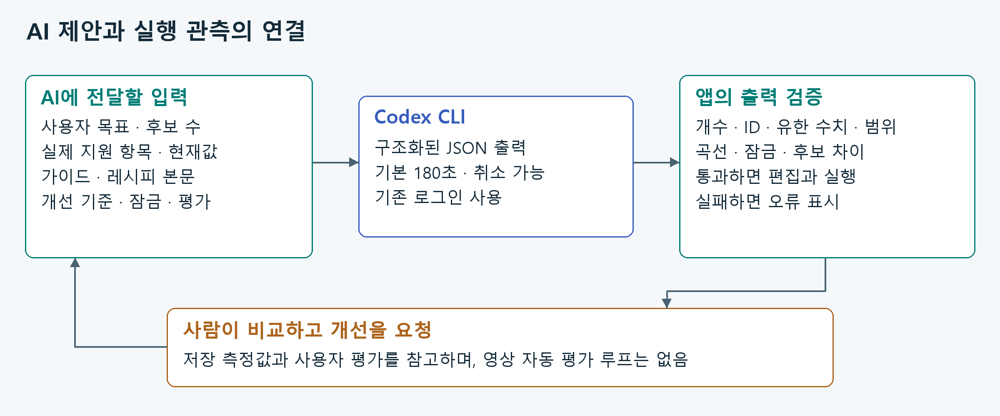

AI는 현재 지원하는 항목, 원본값, 유효 범위·추천 범위, 목표, 가이드와 레시피 본문을 받습니다. Codex CLI가 구조화된 JSON을 생성하면 앱이 후보 수, 항목 ID, 유한 수치, 범위, 잠금과 후보 간 차이를 검사합니다. 오류가 나면 원인을 표시하며 임의 후보로 대체하지 않습니다.

| 기능 | 동작 |
|---|---|
| 넓게 탐색 | 서로 다른 방향의 후보를 제안 |
| 미세 조정 | 선택 후보와 사용자의 평가를 기준으로 개선 |
| 원인별 비교 | 카메라만, 히트스톱만, 한 요인 또는 작은 요인 조합을 검증 |
| 항목 잠금 | 직접 변경뿐 아니라 채널 자동 활성화 같은 간접 변경도 검사 |
| 재현 기록 | 주입한 가이드·레시피 본문, 버전, 해시와 생성 조건 저장 |

내장 레시피는 날카로움, 묵직함, 막타 강조, 광역 충격과 시야 유지를 다룹니다. 수치는 실험 시작점이며 장르 전체에 적용되는 정답이 아닙니다. 추천 범위와 엔진이 허용하는 범위도 구분합니다.

Codex CLI는 임시 디렉터리에서 읽기 전용·도구 비활성화 상태로 호출됩니다. 기존 CLI 로그인을 사용하고 앱은 인증 토큰을 복사하지 않습니다. 기본 생성 제한 시간은 180초이며 취소가 가능합니다. AI 생성에는 로그인된 Codex CLI와 인터넷 연결이 필요합니다.

미세 조정은 연결된 저장 측정값을 참고할 수 있습니다. 수정한 후보의 리비전과 실제 실험값이 다른 경우 이미 측정된 후보처럼 취급하지 않습니다. 영상 자체를 AI가 평가하여 자동으로 다음 실험을 반복하는 기능과 강화학습은 구현 범위에 없습니다.

근거: [후보 생성기](../Desktop/src/ai-candidates.cjs), [타격감 가이드](../Desktop/knowledge/combat-feel-guide.md), [레시피](../Desktop/knowledge/recipe-library.json), [v2 검증](../Desktop/tests/tuning-v2.test.cjs).

## 5 실험 데이터와 v2 편집 규칙

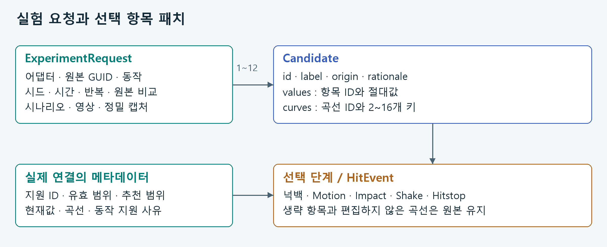

`ExperimentRequest`가 어댑터, 원본 GUID, 동작, 실행 조건과 후보 목록을 고정합니다. 후보에는 값과 곡선, 설명, 출처가 들어갑니다. 동작별 `ParameterSpec`과 곡선 명세는 실제 어댑터에서 조회하며 임의 코드 경로를 입력하지 않습니다.

| 구분 | v1 | v2 |
|---|---|---|
| 값의 의미 | 기존 넉백·카메라 배율과 일괄 히트스톱 | 절대값과 선택 항목 패치 |
| 변경 범위 | 해당 v1 항목 계약에 따름 | 생략한 값·곡선은 원본 유지 |
| 곡선 | 기존 경로 사용 | 편집한 곡선만 2~16개 선형 키로 교체 |
| 실제 원본 비교 | 기준 후보와 원본의 의미 주의 | 후보 패치 없는 별도 control |
| 호환성 | 저장 JSON의 배율 의미 유지 | v1을 절대값으로 자동 재해석하지 않음 |

채널 모드는 `Inherit=0`, `Off=1`, `Override=2`입니다. 값이나 곡선을 바꾸면 해당 채널이 직접 설정으로 활성화되지만, 명시한 모드가 우선합니다. 원본 유지는 기존 개별 타격 override를 지우는 명령이 아니라 그 채널의 원본 상속 관계를 보존하는 선택입니다.

예를 들어 `step.0.hitstop.duration`은 선택 동작의 첫 단계 정지 시간이고 `step.0.hit.0`은 첫 단계의 첫 HitEvent를 가리킵니다. 실제 사용 가능한 ID는 연결이 제공한 목록을 사용합니다. 편집하지 않은 Unity 곡선의 탄젠트·가중치·랩 모드는 유지됩니다.

수치와 시간은 유한해야 하며 timeScale은 0~1입니다. 카메라 최종 FOV는 1~179도, FramingWeight는 0~1로 제한됩니다. 실행 중 제한이 적용되면 `value-limited`에 요청값·실제값·이유를 남깁니다.

근거: [공통 계약](../Packages/com.studiobaekho.combat-lab/Editor/CombatLabContracts.cs), [화면 튜닝 계약](../Desktop/renderer/tuning-contract.js), [v2 게임 연결](../Integrations/FourTigerSword/Editor/FourTigerFeedbackAdapter.cs). JSON 예제는 [v2 사용 및 연결](combat-lab-v2.md)을 참고하세요.

## 6 파일 기반 Unity 연결

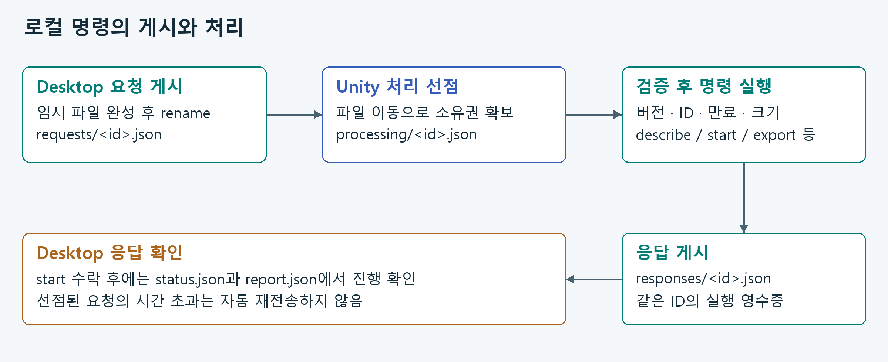

앱과 Unity는 선택 프로젝트의 `Library/CombatLabBridge`에 JSON 파일을 교환합니다. HTTP 서버나 외부 네트워크 포트를 열지 않습니다. 요청 ID는 소문자 32자리 GUID이며 `payloadJson` 안에 명령별 JSON 문자열을 담습니다.

| 명령 | 결과 |
|---|---|
| `describe` | 어댑터, 원본, 동작, 파라미터·곡선과 지원 여부 |
| `start` | 실행 요청을 수락하고 결과 디렉터리 반환 |
| `cancel` | 진행 중인 실험의 취소 요청 |
| `export` | 선택 후보를 새 프리셋 에셋으로 저장 |
| `export-combined` | 동작별 선택 후보를 새 폼 에셋 하나로 저장 |

요청과 응답은 임시 파일을 완전히 쓴 다음 rename하여 게시합니다. Unity가 요청을 `processing`으로 옮겨 처리 권한을 확보하며, 응답은 같은 ID의 중복 실행을 막는 영수증 역할을 합니다. 1 MiB를 넘는 요청, 잘못된 버전·ID·명령과 만료 요청은 거부합니다.

앱은 기본 15초, 시작 명령은 20초 동안 응답을 기다립니다. 시간 초과 시 아직 선점되지 않은 자기 요청만 철회합니다. 이미 선점된 요청은 자동 재전송하지 않고 상태와 결과를 확인합니다. 재로드 후 남은 처리 요청도 무조건 다시 실행하지 않습니다.

`start` 성공은 실행 완료가 아닙니다. 완료와 후보별 상태는 `report.json`에서 확인합니다. 15초 이상 오래된 heartbeat는 연결 끊김으로 보지만 컴파일 등으로 잠시 멈췄을 수도 있습니다. 앱을 닫아도 수락된 Unity 실험은 계속됩니다.

근거: [브리지 구현](../Packages/com.studiobaekho.combat-lab/Editor/CombatLabBridge.cs), [클라이언트](../Desktop/src/project-client.cjs), [상세 API](desktop-bridge.md).

## 7 실험 실행과 시작 조건 검증

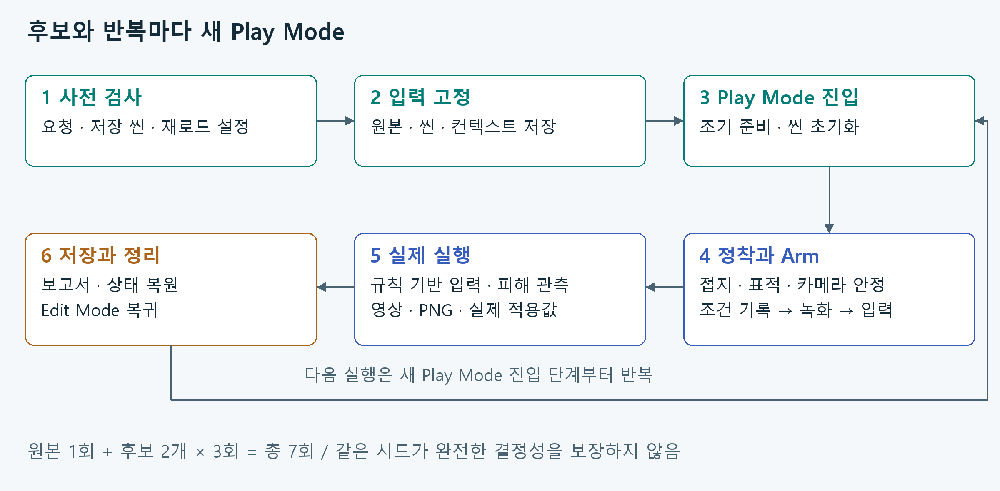

Runner는 요청을 검증하고 원본 스냅샷과 씬 의존성 해시를 저장합니다. v2 피드백 어댑터가 제공하는 경우 편집 모드의 소스 컨텍스트도 저장합니다. 저장되지 않은 씬, 컴파일 중 상태와 실행에 맞지 않는 Play Mode 설정을 확인한 뒤 실행합니다. 씬과 도메인을 모두 재로드하는 설정이 필요합니다.

v2의 원본 control은 후보 패치 없는 원본으로 한 번 실행합니다. 그 다음 각 후보와 반복을 새 Play Mode에서 시작합니다. 원본은 AI 후보 수에 포함되지 않습니다. 후보 2개를 3회씩 비교하면서 원본을 포함하면 총 7회 실행합니다.

고정 표적 모드는 같은 상대 위치·방향을 준비하고 한 동작을 관찰합니다. Four Tiger 연결은 요청 시드로 초기화를 준비하고 필요하면 대기 전투방을 기존 게임 API로 활성화합니다. 접지·표적·렌더 카메라가 연속 3프레임 안정된 뒤 녹화와 입력을 준비합니다.

| 조건 | 판정 기준 |
|---|---|
| 표적 | 안정된 identity가 기준과 일치 |
| 시작 위치 | 플레이어·표적·렌더 카메라 위치 오차 0.02m 이내 |
| 시작 각도와 시야 | 플레이어 yaw, 카메라 회전·FOV 오차 0.1도 이내 |
| 불일치 또는 누락 | `conditions-mismatch` 또는 `conditions-unavailable` |

원본 비교를 요청하면 control이 기준이며, 그 결과가 없으면 조건 확인 불가로 표시합니다. 원본 비교를 요청하지 않은 경우 첫 후보 실행을 기준으로 삼습니다. 실행 실패 상태는 조건 판정으로 덮어 숨기지 않고, 검증 이전 상태도 `fixtureValidation.executionStatus`에 보존합니다. 같은 시드와 조건이 Unity 물리·적 AI·프레임까지 완전히 같은 전투를 보장하지는 않습니다.

종료·취소 시 세션과 캡처를 정리하고 원래 참조와 전역 설정을 복원합니다. Unity 프로세스 강제 종료까지 정상 정리를 보장하는 구조는 아닙니다.

근거: [Runner](../Packages/com.studiobaekho.combat-lab/Editor/CombatLabRunner.cs), [실험 검증](../Packages/com.studiobaekho.combat-lab/Editor/CombatLab.cs), [게임 세션](../Integrations/FourTigerSword/Editor/FourTigerCombatSession.cs).

## 8 게임 어댑터와 공격 데이터

공통 패키지의 필수 경계는 `ICombatLabAdapter`와 `ICombatLabSession`입니다. 어댑터는 원본과 파라미터를 설명하고 실험용 세션을 만듭니다. 세션은 게임을 진행하고 이벤트·측정값을 수집하며 종료 시 상태를 복원합니다. 동작 선택, v2 피드백, 여러 동작 내보내기와 준비 단계는 선택적 인터페이스로 확장합니다.

| 연결 | 현재 역할 |
|---|---|
| FourTigerCombatAdapter | 폼·동작 탐색, 복제, v1 값 적용, 단일·통합 내보내기 |
| FourTigerFeedbackAdapter | v2 항목·곡선 명세, 절대값과 채널 패치, 컨텍스트 |
| FourTigerCombatSession | 가상 입력, 표적·접지 준비, 실행 감지, 피해 기록, 복원 |
| Example 어댑터 | 외부 게임 코드 없이 스크립트 배우가 `RequestAttack()`으로 표적을 공격하는 `strike` 예제 |

Four Tiger는 수·화·목·금·토 폼의 전체 일반 콤보, 개별 일반 타격, 스킬과 궁극기, 수 폼 강공격을 연결합니다. 실제 데이터와 게임 구현이 없는 동작은 사유와 함께 비활성화합니다. 기존 `four-tiger-sword.water` ID는 저장 데이터 호환성을 위해 다섯 폼을 지원해도 유지됩니다.

Four Tiger 연결의 자동 플레이는 가상 입력에서 기존 입력 처리와 실제 상태 머신을 거칩니다. 일반 공격은 LMB, 스킬은 E, 궁극기는 R을 사용합니다. 개별 일반 타격은 실행 복사본에 선택 단계만 남깁니다. 강공격은 실제 홀드와 자원 소모를 거치고, 자원은 시작 시 준비하되 재사용 대기시간은 유지합니다.

화·토·목의 버프 궁극기는 궁극기를 사용한 뒤 일반 공격으로 효과를 관찰합니다. `action-executed`와 `follow-up-attack`을 구분하므로 후속 공격을 궁극기 자체의 직접 명중으로 해석하지 않습니다.

폼 데이터는 `Actions`, `CommonBalance/CommonExecution/CommonFeedback`, `FormBalance/FormExecution/FormFeedback`와 공격·HitEvent의 `Balance/Execution/Feedback`으로 나뉩니다. 실험에서는 폼과 필요한 카메라 프로필을 복제합니다. 플레이어가 없는 씬의 상속 히트스톱은 게임 선언 기본값인 0.25초·배율 0을 기준으로 해석하므로, 씬별 설정을 반영하려면 해당 씬을 열어야 합니다.

근거: [Four Tiger 어댑터](../Integrations/FourTigerSword/Editor/FourTigerCombatAdapter.cs), [세션](../Integrations/FourTigerSword/Editor/FourTigerCombatSession.cs), [Example](../Integrations/Example/Editor/ExampleCombatAdapter.cs), [재사용 안내](reusing-combat-lab.md).

## 9 카메라 피드백과 로컬 히트스톱

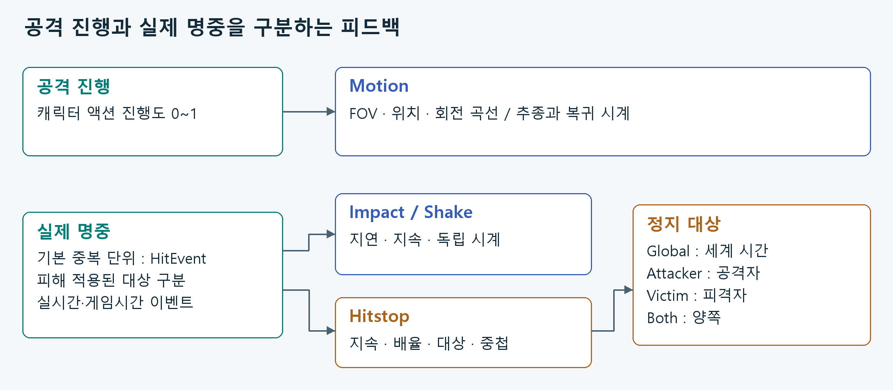

| 채널 | 실행 기준 | 조정하는 값 |
|---|---|---|
| Motion | 공격 진행도 0~1 | FOV·위치·회전 곡선, 구도, 복귀 |
| Impact | 실제 명중 후 지연·지속 시간 | 순간 FOV·위치·회전 킥 |
| Shake | 실제 명중 후 지연·지속 시간 | 절대 이동·회전 진폭, 주파수, 감쇠 |
| Hitstop | 실제 피해가 적용된 타격 | 지속 시간, 시간 배율, 대상과 중첩 |

카메라 채널은 Camera·World·Attack 좌표계와 World·Actor·Unscaled 시계를 선택합니다. 공격 진행 자체는 캐릭터 액션 시계를 따릅니다. Motion의 추종과 복귀, Impact와 Shake는 각각 정해진 시계로 진행합니다. 명중 전에 연출하려면 Motion을 사용하며, 명중 효과에 음수 지연을 넣지 않습니다.

히트스톱 대상은 `Global`, `Attacker`, `Victim`, `Both`입니다. duration은 실제 시간이고 timeScale은 대상의 진행 속도입니다. 로컬 정지는 세계 시간을 바꾸지 않고 공격 타이머·판정·애니메이션·이동·회전·중력·넉백·적 행동과 NavMesh 제어를 함께 연결합니다.

입력 수집과 세계시간 쿨다운·SP 재생 등은 계속됩니다. 입력 버퍼와 홀드 시간은 행위자 시간을 사용해 로컬 정지 중 유지됩니다. 외부 피해·사망은 정지 중에도 처리하고, 재개할 때는 현재 행동과 버프에 맞춰 속도를 다시 계산합니다.

여러 콜라이더에 닿아도 기본적으로 같은 HitEvent의 연출은 한 번만 발생합니다. 피격자별·단계별 모드와 효과 합산·교체·강한 신호 선택도 지원합니다. FOV 곡선 편집 시 기본적으로 Feel 줌을 끄며, Shake의 Off/Override는 기존 Feel 임펄스와의 중복을 막습니다.

이 실행 기능은 게임 쪽 `CombatFeedbackV2`, 카메라 디렉터와 캐릭터 시계 변경이 필요합니다. 공통 UPM 패키지만으로 게임의 로컬 시간을 자동 제어하지는 않습니다.

근거: [피드백 어댑터](../Integrations/FourTigerSword/Editor/FourTigerFeedbackAdapter.cs), [게임 실행부 통합 자료](../Integrations/FourTigerSword/RuntimeIntegration/README.md), [실행부 패치](../Integrations/FourTigerSword/RuntimeIntegration/four-tiger-combat-lab-v2.patch).

## 10 녹화와 정밀 캡처

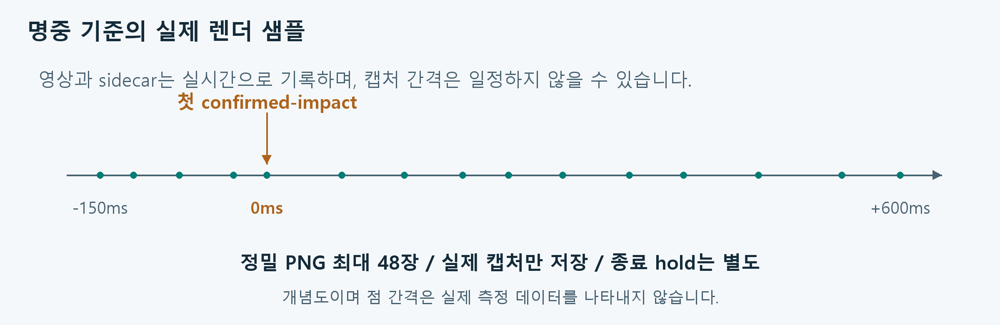

녹화는 게임 시간 대신 벽시계 시간을 사용해 히트스톱을 영상에 포함합니다. 캡처 드라이버가 렌더 샘플을 수집하고 오디오 탭이 소리를 전달합니다. sidecar에는 캡처 인덱스, Unity frameCount, Unity 실시간, 녹화 경과와 영상 PTS를 별도로 기록합니다. PTS는 영상 안에서 해당 프레임이 표시되는 시각입니다.

영상은 1280×720, 최대 60fps를 목표로 하며 실제 샘플 수를 보장하는 수치는 아닙니다. 오디오는 활성 AudioListener와 mono/stereo 설정이 필요하며 영상과의 동기화는 근사치입니다.

정밀 캡처는 선택한 대상의 첫 `confirmed-impact` 전 150ms부터 후 600ms까지 최대 48장의 실제 샘플을 보존합니다. PNG 압축은 녹화가 끝난 후 수행합니다. 종료 시 마지막 영상 프레임을 유지하는 `terminalHold`는 새 렌더 샘플이나 정밀 PNG로 세지 않습니다.

| 상태 | 의미 |
|---|---|
| `disabled` | 정밀 캡처를 사용하지 않음 |
| `missing-hit` | 기준으로 삼을 명중이 없음 |
| `complete` | 요구한 명중 구간의 자료가 확보됨 |
| `incomplete` | 구간 누락·버퍼 초과·PNG 손실 등으로 자료가 불완전함 |

비교 화면의 이전·다음 캡처는 저장한 실제 PNG를 이동합니다. 원본과 후보는 같은 명중 상대 시각에 가장 가까운 샘플로 맞추고 정렬 오차를 표시합니다. 없는 중간 이미지는 보간해서 만들지 않습니다.

실제 캡처 간격은 일정하지 않습니다. 중앙값, 최대값과 33.333ms 초과 간격 수를 함께 확인해야 합니다. 모든 시뮬레이션 프레임을 보존하는 기능은 아니며, 일반 영상의 시간 탐색도 정확한 프레임 이동을 보장하지 않습니다. 녹화 중에는 Game View를 유지하고 Unity를 최소화하지 않는 것이 필요합니다.

근거: [녹화](../Packages/com.studiobaekho.combat-lab/Editor/CombatLabRecording.cs), [캡처 메타데이터](../Packages/com.studiobaekho.combat-lab/Editor/CombatLabCaptureMetadata.cs), [드라이버](../Packages/com.studiobaekho.combat-lab/Runtime/CombatLabCaptureDriver.cs), [오디오](../Packages/com.studiobaekho.combat-lab/Runtime/CombatLabAudioTap.cs).

## 11 결과 비교와 기록

결과 화면은 여러 후보 영상을 같은 논리적 시간축으로 재생합니다. 비교 개수를 줄이면 필요한 영상만 로드하고, 후보를 교체할 때 기존 선택과 자리를 바꿉니다. 첫 명중 정렬, 재생 속도와 한 후보의 소리를 선택할 수 있습니다. 정밀 자료가 있는 경우 원본과 후보의 실제 PNG를 함께 봅니다.

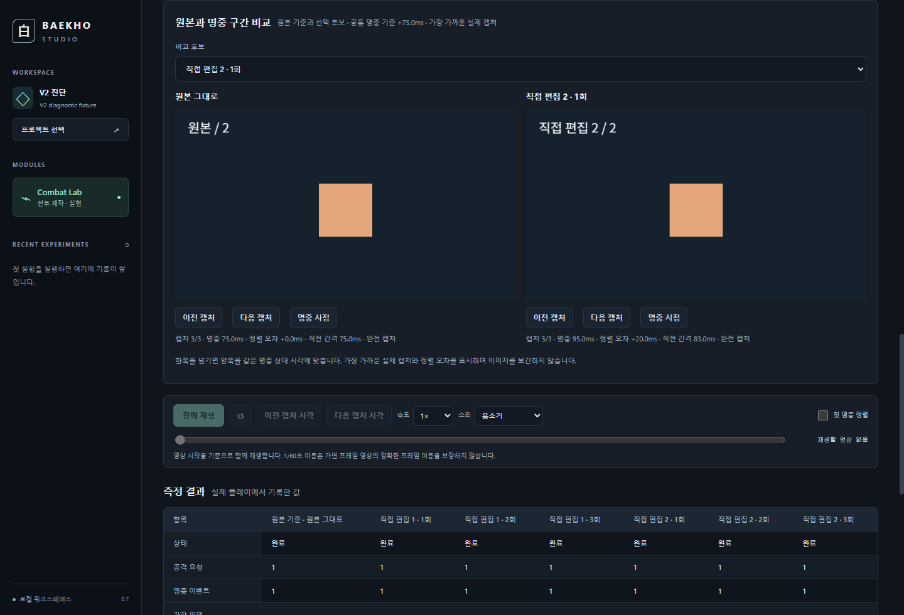

위 화면은 기존 배포 진단의 합성 이미지입니다. 화면 동작과 정렬 오차 표시를 보여주며 실제 게임 플레이 장면은 아닙니다.

| 결과 파일 | 담는 내용 |
|---|---|
| `request.json` | 고정된 실험 조건, 후보와 AI 생성 근거 |
| `source-snapshot.json` | 원본 공격 데이터 |
| `source-context.json` | v2 피드백 어댑터가 제공한 편집 모드 컨텍스트, 해시·시각 연결 |
| `scene-dependency-hash.txt` | 시작 씬 의존성 해시 |
| `report.json` | 후보·반복별 상태, 피해 이벤트, 실제 적용값과 조건 검증 |
| 영상과 `.frames.json` | 플레이 영상, 실제 캡처 시각과 품질 |
| `.frames/*.png` | 명중 전후 정밀 이미지 |
| `judgment.json` | 사람이 선택한 후보와 이유 |
| `index.html` | 별도로 열 수 있는 비교 보고서 |

근거: [보고서 생성](../Packages/com.studiobaekho.combat-lab/Editor/CombatLabReport.cs), [결과 열기](../Desktop/src/project-client.cjs), [비교 화면](../Desktop/renderer/app.js).

## 12 프리셋과 여러 동작 저장

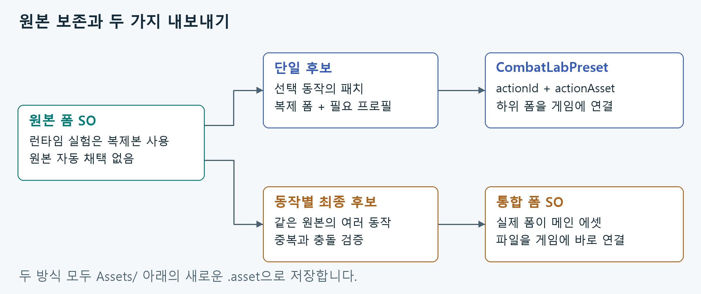

단일 후보 내보내기는 `CombatLabPreset`을 새 파일로 만들고 복제한 폼을 `actionAsset`에, 대상 동작을 `actionId`에 보관합니다. 필요한 카메라 프로필도 하위 에셋으로 저장합니다. 게임에 채택하려면 프리셋 아래의 폼 SO를 플레이어의 해당 폼 참조에 연결합니다.

여러 동작 저장은 같은 원본 폼에서 고른 최종 후보들을 합쳐 실제 폼 SO를 파일의 메인 객체로 만듭니다. 이 파일은 플레이어의 폼 참조에 바로 연결할 수 있습니다. 카메라 복사본은 같은 파일의 하위 에셋이며 선택하지 않은 동작은 유지됩니다.

| 검증 항목 | 규칙 |
|---|---|
| 대상 | 같은 어댑터와 같은 원본 폼 |
| 선택 | 동작별 유효한 후보가 실제 목록에 존재 |
| 중복 | 동일 동작 중복 금지, 전체 콤보와 개별 타격 충돌 금지 |
| 저장 위치 | `Assets/` 아래의 새로운 `.asset`, 상위 폴더 존재 |
| 원본 | 원본 SO를 덮어쓰거나 자동 채택하지 않음 |

모든 선택을 먼저 검증한 뒤 복제·적용·저장합니다. 잘못된 선택 때문에 일부 동작만 담긴 결과를 의도적으로 남기지 않습니다. 통합 저장은 `ICombatLabMultiActionAdapter` 지원이 필요하며 Four Tiger 연결이 이를 구현합니다.

근거: [프리셋 계약](../Packages/com.studiobaekho.combat-lab/Editor/CombatLabPreset.cs), [내보내기](../Integrations/FourTigerSword/Editor/FourTigerCombatAdapter.cs), [통합 내보내기 회귀](../Tests/FourTigerCombinedExportRegression.cs).

## 13 설치와 다른 게임 연결

Windows 배포물은 `Baekho Studio.exe`가 들어 있는 폴더 전체를 복사해 실행합니다. Electron 런타임이 포함되어 Node.js를 따로 설치할 필요는 없습니다. AI 후보 생성에는 별도로 설치·로그인한 Codex CLI가 필요합니다. 배포물에는 공통 패키지, 어댑터와 설치 스크립트가 담긴 `UnityIntegration`도 포함됩니다.

| 설치 대상 | 준비할 것 |
|---|---|
| 공통 연결 | Unity 6000.3 이상, 공통 UPM 패키지 |
| 독립 예제 | `Install-CombatLab.ps1 -Adapter Example`, 예제 씬 생성 |
| Four Tiger | 공통 패키지, Editor 어댑터 3파일, 게임 v2 실행부 |
| 새 게임 | 해당 게임의 SO·입력·피해·복원을 연결하는 어댑터와 세션 |

프로젝트를 닫은 상태에서 다음과 같이 독립 예제를 설치합니다.

```powershell
./scripts/Install-CombatLab.ps1 -UnityProject 'C:/path/to/MyGame' -Adapter Example
```

Unity를 열고 `Tools > Baekho > Combat Lab Example > Create Demo Scene`으로 예제 씬을 만든 뒤 앱에서 프로젝트를 선택합니다. 실제 Combat Lab 편집 UI는 독립 앱에 있으며 예전 Unity 편집 창은 사용하지 않습니다.

설치기는 다른 기존 파일이 있으면 기본적으로 중단합니다. 검토 후 `-Force`로 업데이트하면 변경 대상의 기존 파일을 `CombatLabInstallBackups`에 백업하고 기존 `.meta` GUID를 보존합니다. 패키지는 대상 프로젝트에 복사되어 이 저장소의 절대 경로에 의존하지 않습니다.

Four Tiger 실행부 패치는 54개 파일의 통합 자료입니다. 기준은 사용자 수정이 포함된 작업 전 스냅샷이며 upstream 커밋이 아닙니다. 설치기는 이 패치를 게임 소스에 자동 적용하지 않습니다. 다른 체크아웃은 수동 병합 후 해당 프로젝트에서 컴파일과 플레이를 검증해야 합니다.

앱 개발 검사는 `Desktop`에서 `pnpm test`, 실행은 `pnpm start`, Windows 패키징은 `pnpm package:win`으로 수행합니다. 빌드된 게임 제어, 원격 장비 연결, 여러 프로젝트 동시 실행과 새로운 게임 전투 구조의 자동 추론은 제공하지 않습니다.

근거: [공통 설치기](../scripts/Install-CombatLab.ps1), [Four Tiger 설치기](../scripts/Install-FourTigerAdapter.ps1), [배포 스크립트](../Desktop/scripts/package.cjs), [실행부 통합](../Integrations/FourTigerSword/RuntimeIntegration/README.md).

## 14 검증된 범위와 읽는 순서

| 검증 | 날짜와 범위 | 결과 |
|---|---|---|
| Desktop 자동 테스트 | 2026-11-04 현재 작업 트리에서 `node --test tests/*.test.cjs` 실행 | 120 통과, 0 실패 |
| 대표 동작 플레이 | 2026-10-23 기존 Unity 검증 기록, 한 Play Mode에서 진단 실행 | 대표 17개 완료, 정밀 구간 complete |
| 일반 Runner 격리 | 2026-10-23 기존 기록, 원본 1회와 후보 2개씩 3회 | 7회 완료, 후보 6회 시작 조건 matched |
| 내보낸 SO 직접 실행 | 2026-10-23 기존 기록 | 실제 설정 동등, 원본 보존 |
| 배포 진단 | 저장된 `packaged-v2-final-runtime.json` | 화면 오류 없음, 정밀 선택·공통 시각 유지 |
| 설치 키트와 패치 | 저장된 `packaging-final.json` | 키트 51파일 일치, 실행부 패치 54파일 확인 |

Unity 수치는 기존 실행 기록의 범위입니다. 이번 문서 작업에서 Unity 플레이 검증을 다시 실행하지 않았습니다. Desktop 테스트의 파일 symlink 검사는 Windows 개발자 모드 제약이 있었고 junction 경계 검사는 통과했습니다. 120개 통과를 모든 OS 권한 조합의 검증으로 해석하지 않습니다.

피해량과 명중 수는 전투 관측값이며 타격감 점수가 아닙니다. 부가 효과가 피해 이벤트에 포함될 수 있어 `hits`와 선택 공격의 `confirmed-impact` 수는 다를 수 있습니다. AI 설명 역시 기대 효과이며 실제 평가와 구분합니다.

| 알고 싶은 내용 | 먼저 읽을 문서 또는 코드 |
|---|---|
| 앱 시작과 기본 사용 | [README](../README.md) |
| 절대값·카메라·히트스톱 상세 | [Combat Lab v2](combat-lab-v2.md) |
| 로컬 명령 프로토콜 | [Desktop 브리지](desktop-bridge.md) |
| 새 게임에 이식 | [다른 프로젝트 연결](reusing-combat-lab.md) |
| 실제 플레이의 증거와 한계 | [v2 실행 검증 기록](combat-lab-v2-validation.md) |
| 게임 코드 통합 | [RuntimeIntegration 안내](../Integrations/FourTigerSword/RuntimeIntegration/README.md) |
| 앱 회귀 | [Desktop/tests](../Desktop/tests) |
| Unity 회귀 | [Tests](../Tests) |

문서의 그림 원본은 `docs/images/systems/*.svg`, 화면 이미지는 같은 폴더의 PNG입니다. [문서 생성 스크립트](../scripts/Build-SystemDocs.py)는 다이어그램과 공유용 PDF를 같은 문서에서 생성합니다. PDF는 `output/pdf/baekho-studio-systems.pdf`에 저장됩니다.
