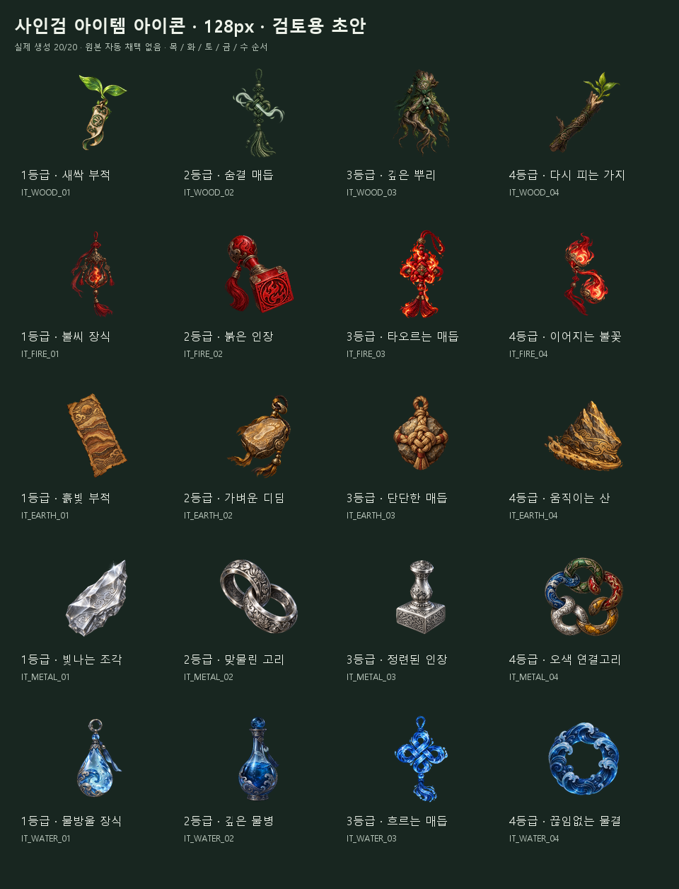

# 사인검 실제 생성 초안 20개

5오행 × 4등급의 아이템 초안과 실제 생성한 아이콘입니다. **모두 draft이며 채택 0개**입니다. 개별 효과·수치·상한·아트는 검토할 제안입니다.

- `93190cd9-a826-4b58-b257-cf4ba077b827/draft.json`: 앱에서 이어 편집할 프로젝트 revision 72. 생성 기록과 상대 파일 경로를 보존했습니다.
- 같은 폴더의 `icons/`: 아이템별 원본 `source.png` 20개와 256px `icon-256.png` 20개. 이미지 바이트와 해시는 기존 완료 결과 그대로입니다.
- 같은 폴더의 `review-bundle/`: revision 71의 Unity용 JSON·PNG 초안, manifest, 규칙 검증 보고서, README. 출력 이력이 revision 72에 추가되어 번호가 다릅니다.

앱에서 이어 편집하려면 UUID 폴더를 별도 백호툴 데이터 루트의 `four-tiger-items/` 아래에 복사합니다. 동일 UUID가 이미 있으면 덮어쓰지 말고 별도 데이터 루트를 사용합니다. `BAEKHO_DATA`로 데이터 루트를 지정할 수 있습니다. Git의 예제 폴더 자체를 작업 데이터 루트로 사용하지 마세요.

Unity용 묶음은 JSON을 TextAsset, PNG를 Texture2D/Sprite로 반입합니다. 실제 Unity 6000.3.10f1에서 Texture20/Sprite20/오류0을 확인했습니다. 게임 내 아이템 보유·전투 효과 및 ItemDefinition/ScriptableObject 연동은 구현 범위 밖입니다. 사용 흐름은 [제작 도구 문서](../../docs/four-tiger-items.md)를 참고하세요.

기준 기획: `lala11112/Four-Tiger-Sword`, `codex/system-design-2026-10-07@fe533a25a0df81eb317059ee18708229d63320ad`. 기존 구현 커밋 `35274bac6a33edee712ce12b0921c4db5d19b97d` 위에 실제 에셋만 추가했습니다. 초기 생성 호출 전 런타임 실패2건과 성공20건의 기록을 보존했고 새 생성은 하지 않았습니다.

실행 ZIP, 빌드 출력, 원시 작업 로그, 자격증명과 사용자 절대 경로는 포함하지 않습니다.
